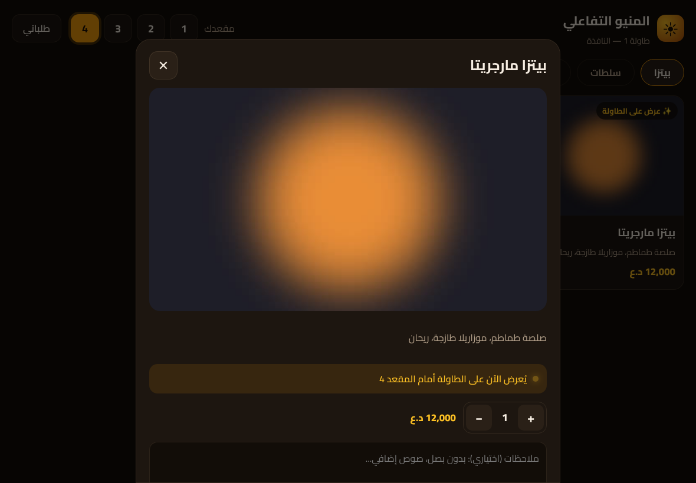
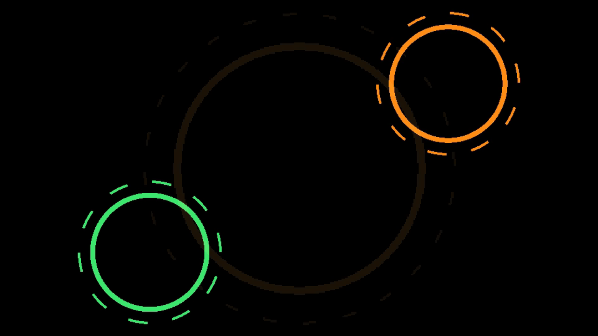
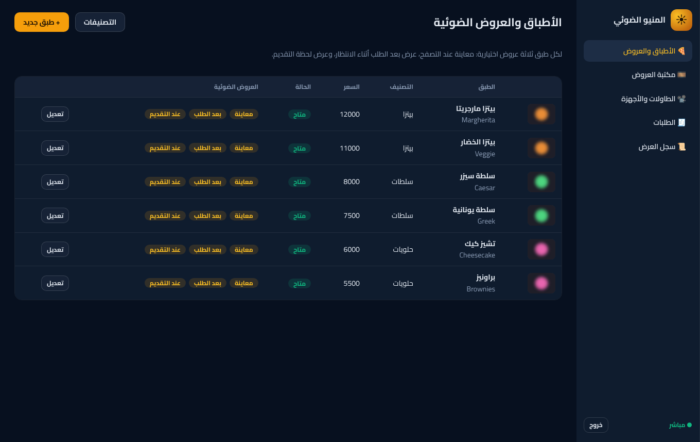
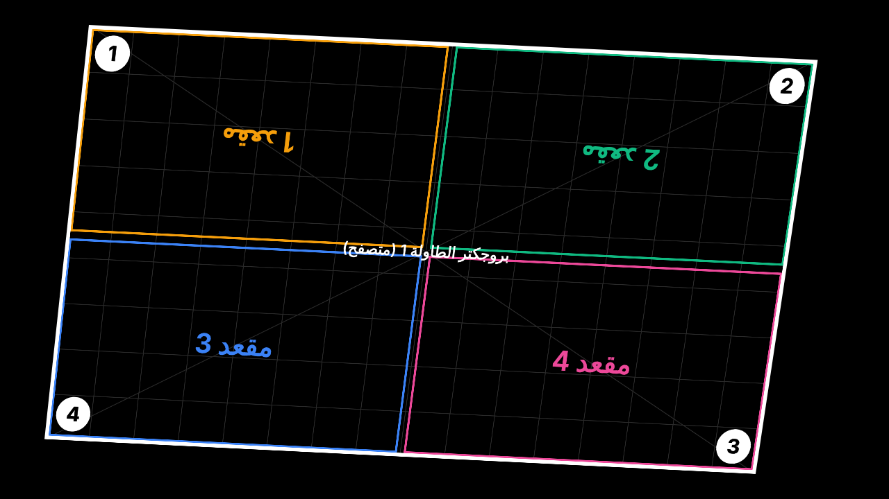
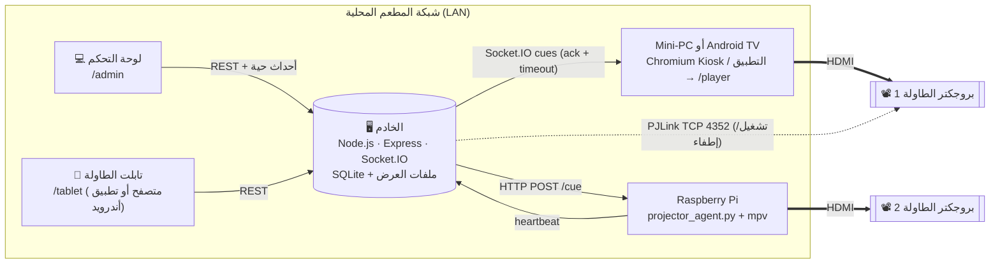
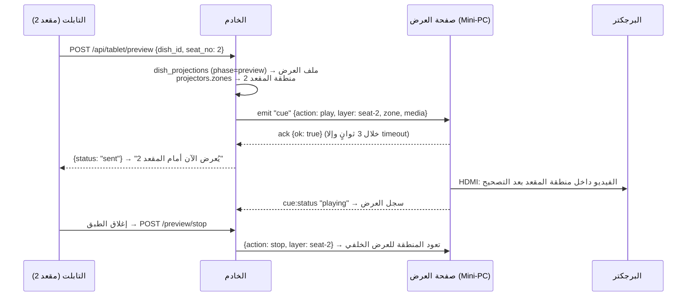
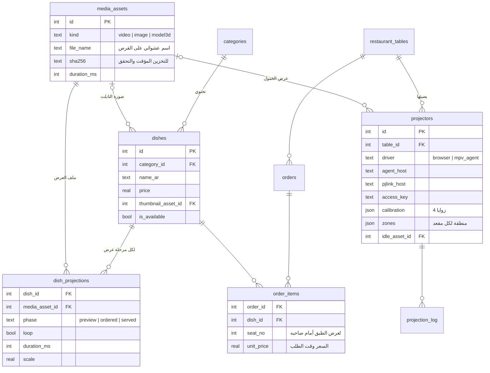

# منيو الإسقاط الضوئي التفاعلي (Projection Mapping Menu)

نظام لإدارة منيو طعام يُعرض بالإسقاط الضوئي على طاولات المطعم. يتكوّن من ثلاثة أجزاء:

- **لوحة تحكم** يرفع منها المدير تصاميم وفيديوهات الـ 3D، ويربط كل طبق بعروضه الضوئية.
- **واجهة طلب على التابلت.** عندما يفتح الزبون طبقاً يظهر عرضه الضوئي فوراً على الطاولة أمام مقعده.
- **طبقة ربط مع أجهزة العرض** تعمل عبر HDMI وشبكة المطعم المحلية. تتضمن تصحيح تشوّه الصورة على سطح الطاولة (Corner-pin) وتقسيم السطح إلى مناطق للمقاعد.

ومعها **تطبيق أندرويد (APK)** يحوّل التابلت أو جهاز Android TV أو البرجكتر الذكي إلى جهاز مخصّص للنظام بملء الشاشة، ويُربط بالخادم بمسح رمز QR من لوحة التحكم (القسم 7).

> الكود هنا نموذج أولي يعمل فعلاً ومغطّى باختبارات آلية، وليس مجرد مقتطفات.

| واجهة التابلت | ما يظهر على الطاولة (مقعدان في وقت واحد) |
|---|---|
|  |  |
| **لوحة التحكم** | **شاشة المعايرة بعد تصحيح الزوايا** |
|  |  |

---

## 1. المعمارية (Architecture)



**الفكرة الأساسية:** البرجكتر نفسه مجرد شاشة. منفذ HDMI ينقل الصورة فقط، لذلك "إرسال أمر للبرجكتر" يعني عملياً إرسال أمر إلى **الكمبيوتر الصغير المتصل به**، وهذا الكمبيوتر هو الذي يشغّل الفيديو. أوامر الشبكة التي يفهمها البرجكتر (PJLink أو RS-232) تتحكم فقط بالطاقة والمدخل، ولا تتحكم بالمحتوى.

### تسلسل الأحداث عند اختيار طبق



لكل طبق ثلاث **مراحل** عرض اختيارية، وكلها قابلة للربط من لوحة التحكم:

| المرحلة | متى تُشغَّل | مثال |
|---|---|---|
| `preview` | عند فتح الطبق على التابلت | البيتزا ثلاثية الأبعاد تدور أمام الزبون |
| `ordered` | بعد تأكيد الطلب أثناء الانتظار | الشيف يحضّر الطبق، أو حلقة "قيد التحضير" |
| `served` | عندما يضغط المطبخ "تم التقديم" | تموجات ضوئية حول الصحن (مرة واحدة) |

---

## 2. التقنيات المقترحة ولماذا

| الطبقة | التقنية | السبب |
|---|---|---|
| الخادم | **Node.js 22 + Express 5** | نظام تحكم لحظي قائم على الأحداث، ونفس اللغة في الواجهات والخادم |
| الاتصال اللحظي | **Socket.IO** | يدعم تأكيد الاستلام مع مهلة (ack + timeout)، وغرفة لكل جهاز عرض، وإعادة الاتصال التلقائية، وزمن استجابة أقل من 50ms على الشبكة المحلية |
| قاعدة البيانات | **SQLite** (better-sqlite3) | ملف واحد بلا إدارة، ومناسبة لمطعم واحد. المخطط ينتقل إلى **PostgreSQL** بتعديلات بسيطة عند التوسع لعدة فروع |
| الواجهات | **HTML + ES Modules** بدون build | تُحمَّل بسرعة من خادم محلي حتى بدون إنترنت. كل شاشة وحدة مستقلة (`views/*.js`)، فالانتقال إلى **React/Vite** لاحقاً سهل |
| مشغّل العرض (الخيار الأول) | **Chromium Kiosk** + فيديو HTML5 + تحويل CSS `matrix3d` + **three.js** | تصحيح التشوه يتم على كرت الشاشة (GPU)، ويمكن تشغيل عدة مقاعد في وقت واحد، وعرض نماذج `.glb` حية |
| مشغّل العرض (الخيار الثاني) | **Python 3 + mpv** (JSON IPC) + فلتر ffmpeg `perspective` | خفيف جداً على Raspberry Pi، ولا يحتاج سطح مكتب ولا متصفح |
| التحكم بالبرجكتر | **PJLink** عبر الشبكة، و **HDMI-CEC** | بروتوكولات قياسية تدعمها معظم البرجكترات التجارية |
| تطبيق الأجهزة | **Android (Kotlin) + WebView** + androidx.webkit + ZXing | نفس صفحات الويب بلا تكرار، مع ما لا يقدر عليه المتصفح: قفل Kiosk، وتشغيل تلقائي، ومسح QR، وعرض تجريبي بدون خادم |
| إنتاج المحتوى | Blender / Cinema 4D / After Effects → MP4 (H.264) أو WebM (VP9) | الفيديو المُصيَّر مسبقاً هو الأكثر ثباتاً وجودة على الطاولة |

---

## 3. هيكل المشروع

```
projection-menu/
├── src/
│   ├── server.js                 نقطة التشغيل
│   ├── app.js                    تجميع Express + Socket.IO + المشغلات
│   ├── config.js                 الإعدادات (متغيرات البيئة)
│   ├── sockets.js                namespaces: /player و /admin
│   ├── db/
│   │   ├── schema.sql            ← مخطط قاعدة البيانات
│   │   ├── index.js
│   │   └── seed.js               بيانات تجريبية + توليد مقاطع عرض بـ ffmpeg
│   ├── routes/
│   │   ├── menu.js               التصنيفات، الأطباق، ربط الطبق بالعرض
│   │   ├── media.js              رفع ملفات العرض (فيديو/صورة/glb)
│   │   ├── devices.js            الطاولات، البرجكترات، المعايرة، المناطق، الطاقة
│   │   ├── orders.js             الطلبات وسجل العرض (للإدارة/المطبخ)
│   │   ├── tablet.js             واجهة التابلت: المنيو، المعاينة، الطلب
│   │   └── agent.js              heartbeat لوكلاء mpv
│   ├── services/
│   │   ├── projectionService.js  ← قلب النظام: حدث → جهاز العرض والمنطقة → أمر
│   │   ├── drivers/
│   │   │   ├── browserDriver.js  أوامر Socket.IO لصفحة العرض
│   │   │   └── mpvAgentDriver.js أوامر HTTP لوكيل Raspberry Pi
│   │   ├── pjlink.js             تشغيل/إطفاء البرجكتر عبر الشبكة
│   │   ├── media.js              الرفع، SHA-256، ffprobe
│   │   └── orders.js
│   ├── routes/system.js          معلومات الخادم لرموز QR + تنزيل التطبيق /app.apk
│   └── lib/                      التحقق، المصادقة، مناطق المقاعد، network.js (عناوين الشبكة)
├── public/
│   ├── admin/                    لوحة التحكم (+ pairing.js و qr.js: روابط ورموز QR للربط)
│   ├── tablet/                   واجهة الطلب
│   ├── player/                   صفحة العرض على البرجكتر (+ model-renderer.js لـ glb)
│   └── shared/homography.js      ← رياضيات تصحيح الزوايا الأربع
├── android/                      تطبيق أندرويد (Kotlin + WebView) — القسم 7
│   ├── app/src/main/java/…       النشاط الرئيسي، تحليل روابط الربط، Kiosk، PIN، الإقلاع التلقائي
│   ├── app/src/main/assets/      app/ شاشة الإعداد · demo/ العرض التجريبي · media/ مقاطعه
│   ├── app/src/test/             اختبارات JVM (./gradlew test)
│   └── tools/make-demo-media.mjs توليد مقاطع العرض التجريبي بـ ffmpeg
├── dist/ProjectionMenu.apk       نسخة التطبيق الجاهزة (يقدّمها الخادم على /app.apk)
├── agent/projector_agent.py      وكيل Raspberry Pi (مكتبة Python القياسية فقط)
├── deploy/                       systemd + سكربت Kiosk
└── test/                         اختبارات node:test
```

---

## 4. قاعدة البيانات (Database Schema)

المخطط الكامل مع التعليقات موجود في [`src/db/schema.sql`](src/db/schema.sql).



**قرارات تصميم مهمة:**

- مسارات الملفات لا تُخزَّن كاملة. يُخزَّن `file_name` فقط (UUID عشوائي)، ويُبنى الرابط `/media/<file_name>`. بهذا يمكن نقل مجلد الوسائط أو تغيير الخادم بدون تعديل البيانات، ويمكن تخزين الملفات مؤقتاً للأبد (immutable cache).
- `dish_projections` جدول ربط مستقل وليس عموداً في `dishes`، لأن لكل طبق عدة عروض (مرحلة لكل عرض) ويمكن مشاركة ملف واحد بين عدة أطباق.
- حذف ملف مرتبط بطبق ممنوع (`ON DELETE RESTRICT`). أما صورة الطبق وعرض الخمول فتُفرَّغ تلقائياً (`SET NULL`).
- `calibration` و `zones` بصيغة JSON لأنها تُقرأ وتُكتب ككتلة واحدة ولا يُستعلم عنها. في PostgreSQL تصبح `JSONB`.

أمثلة على الحقول:

```jsonc
// projectors.calibration — أين تقع زوايا "المسرح" على خرج البرجكتر (نسب 0..1)
{ "corners": [[0.04,0.03], [0.97,0.05], [0.95,0.97], [0.02,0.94]] }   // TL, TR, BR, BL

// projectors.zones — المنطقة أمام كل مقعد؛ rotate:180 لمقاعد الجهة المقابلة
[ { "seat": 1, "x": 0,   "y": 0,   "w": 0.5, "h": 0.5, "rotate": 180 },
  { "seat": 2, "x": 0.5, "y": 0,   "w": 0.5, "h": 0.5, "rotate": 180 },
  { "seat": 3, "x": 0,   "y": 0.5, "w": 0.5, "h": 0.5, "rotate": 0 },
  { "seat": 4, "x": 0.5, "y": 0.5, "w": 0.5, "h": 0.5, "rotate": 0 } ]
```

---

## 5. بروتوكول الأوامر (Cue Protocol)

الأمر رسالة JSON واحدة ونفس الصيغة لكل أنواع المشغلات. الكود في [`projectionService.js`](src/services/projectionService.js).

```jsonc
// تشغيل عرض في منطقة مقعد
{ "cueId": "uuid", "action": "play", "layer": "seat-2",
  "zone":  { "x": 0.5, "y": 0, "w": 0.5, "h": 0.5, "rotate": 180 },
  "media": { "kind": "video", "url": "/media/9f1c….webm", "sha256": "…" },
  "loop": true, "durationMs": null, "scale": 1, "fadeMs": 500,
  "meta":  { "dishId": 1, "dishName": "بيتزا مارجريتا", "phase": "preview" } }

{ "cueId": "uuid", "action": "stop", "layer": "seat-2" }          // layer: null = إيقاف الكل
{ "cueId": "uuid", "action": "config", "calibration": {…}, "zones": […], "idle": {…} }
{ "cueId": "uuid", "action": "test_pattern", "on": true }
```

نتائج الإرسال تُسجَّل في `projection_log` وتظهر في "سجل العرض" بلوحة التحكم:
`acked` (استلم) · `offline` (غير متصل) · `timeout` (لم يرد خلال 3 ثوانٍ) · `failed` · ثم من المشغّل نفسه: `playing` / `ended` / `error`.

مثال مختصر لقلب النظام:

```js
// src/services/projectionService.js
async playDish({ tableId, dishId, phase, seatNo = null }) {
  const projection = this.stmt.dishProjection.get(dishId, phase);   // الطبق ← ملف العرض
  if (!projection) return { status: 'no_projection', results: [] };

  const targets = this.resolveTargets(tableId, seatNo);              // المقعد ← البرجكتر + المنطقة
  const results = await Promise.all(targets.map(({ projector, layer, zone }) =>
    this.send(projector, { action: 'play', layer, zone, media: mediaRef(projection),
                           loop: Boolean(projection.loop), durationMs: projection.duration_ms })));
  return { status: results.some((r) => r.ok) ? 'sent' : 'failed', results };
}
```

---

## 6. الربط مع أجهزة العرض (Projector Integration)

### الخيار A (المُوصى به): كمبيوتر صغير + متصفح عبر HDMI

```
[البرجكتر] ◄──HDMI── [Mini-PC أو Raspberry Pi 5] ──Ethernet── [الخادم]
                        Chromium --kiosk /player/?projector=1&key=…
```

1. أضف جهاز عرض من **لوحة التحكم ← الطاولات والأجهزة**، وانسخ رابط العرض.
2. على الكمبيوتر المتصل بالبرجكتر شغّل:
   ```bash
   PLAYER_URL="http://192.168.1.10:3000/player/?projector=1&key=XXXX" deploy/kiosk-player.sh
   ```
   السكربت يفتح Chromium بملء الشاشة، ويسمح بالتشغيل التلقائي، ويمنع إطفاء الشاشة.
3. تتصل الصفحة بالخادم عبر Socket.IO وتنتظر الأوامر. لا يلزم فتح أي منفذ على الجهاز، وتعيد الاتصال تلقائياً. إذا انقطع الخادم يستمر العرض الحالي.

الملف [`public/player/player.js`](public/player/player.js) هو الذي:
- يرسم كل شيء على "مسرح" 1920×1080 يمثّل سطح الطاولة، ثم يطبّق تحويل **homography** عبر `matrix3d` حتى تنطبق زواياه على زوايا الطاولة الفعلية.
- يضع كل عرض في منطقة مقعده ويدوّره 180° للمقاعد المقابلة. يستخدم `mix-blend-mode: screen` حتى يصبح الأسود شفافاً وتندمج العروض مع الخلفية.
- يشغّل الفيديو والصور، ونماذج `.glb` بـ three.js التي تُحمَّل محلياً من الخادم بدون إنترنت.

### الخيار B: Raspberry Pi + mpv (بدون متصفح)

```bash
sudo apt install mpv cec-utils
python3 agent/projector_agent.py --server http://192.168.1.10:3000 --projector 2 --key XXXX --cec
```

- يفتح الوكيل المنفذ `8765` ويستقبل `POST /cue` بنفس صيغة الأوامر، بشرط أن يحمل الطلب ترويسة `X-Projector-Key`.
- يتحكم بـ mpv عبر IPC، ويركّب المنطقة والدوران وتصحيح الزوايا في سلسلة فلاتر ffmpeg واحدة:
  `scale → pad → hflip,vflip → pad 1920x1080 → perspective`.
- يخزّن الفيديوهات محلياً بالـ SHA-256، فيُشغَّل الملف من القرص في المرة الثانية، ويستمر العرض إذا أُعيد تشغيل الخادم.
- يرسل heartbeat كل 10 ثوانٍ، فيظهر "متصل" في اللوحة ويستلم الإعدادات تلقائياً بعد إعادة التشغيل.
- `--cec` يشغّل البرجكتر عبر HDMI-CEC عند الإقلاع.
- **القيد:** mpv يعرض مقطعاً واحداً في كل لحظة، لذلك آخر مقعد يُطلب يأخذ العرض. لتشغيل عدة مقاعد في وقت واحد استخدم الخيار A.
- ملف systemd جاهز: [`deploy/projector-agent.service`](deploy/projector-agent.service).

### الخيار C: Android TV Box أو بروجكتر بنظام أندرويد

بدون كمبيوتر: ثبّت تطبيق أندرويد على صندوق Android TV موصول بالبرجكتر عبر HDMI، أو على البرجكتر نفسه إذا كان بنظام أندرويد، وامسح رمز QR الخاص بجهاز العرض (أو اكتب رابطه بالريموت). التطبيق يفتح نفس صفحة `/player` بملء الشاشة وبالعرض الأفقي، فكل ميزات الخيار A متاحة: عدة مقاعد معاً، والمعايرة، ونماذج `.glb`. التفاصيل في القسم 7.

### التحكم بطاقة البرجكتر

- **PJLink** (TCP 4352): أدخل IP البرجكتر وكلمة مروره في إعدادات الجهاز، فتظهر أزرار "تشغيل/إطفاء البرجكتر". التنفيذ في [`src/services/pjlink.js`](src/services/pjlink.js) ويدعم المصادقة بـ MD5.
- **HDMI-CEC**: عبر `cec-client` على جهاز الوكيل.
- **RS-232**: للبرجكترات القديمة. يمكن إضافة مشغّل مشابه لـ `pjlink.js` بمكتبة `serialport`.

### نصائح عملية للإسقاط على الطاولة

| البند | التوصية |
|---|---|
| البرجكتر | ليزر قصير المدى (Short-throw)، 3500–5000 لومن، عمر تشغيل 20,000 ساعة أو أكثر |
| التركيب | في السقف فوق مركز الطاولة، مع إمالة خفيفة وتصحيح الباقي بالمعايرة من اللوحة |
| سطح الطاولة | مطفي (Matte) فاتح اللون. الأسطح اللامعة تعكس بقعة ضوء في عين الزبون |
| المحتوى | **خلفية سوداء دائماً**، لأن الأسود يعني عدم إسقاط أي ضوء. صمّم حول الصحن وليس عليه، وتجنّب المساحات البيضاء الكبيرة |
| الإضاءة | خفّف إضاءة السقف المباشرة فوق الطاولات واستخدم إضاءة جانبية دافئة |
| الشبكة | Ethernet لأجهزة العرض، وشبكة VLAN منفصلة للأجهزة عن شبكة الزبائن |

---

## 7. تطبيق أندرويد (APK)

تطبيق واحد في مجلد [`android/`](android) (Kotlin + Android WebView) يحوّل أي جهاز أندرويد إلى جهاز مخصّص للنظام. دور الجهاز يُحدَّد من الرابط الذي يُمسح عند الإعداد:

| الوضع | الجهاز | ماذا يفتح |
|---|---|---|
| `TABLET` | تابلت الطاولة | `/tablet/?table=…&key=…` بملء الشاشة، مع قفل اختياري |
| `PLAYER` | Android TV Box أو بروجكتر بنظام أندرويد عبر HDMI | `/player/?projector=…&key=…` بملء الشاشة وبالعرض الأفقي |
| `ADMIN` | جوال أو تابلت المدير والمطبخ | `/admin/` كتطبيق عادي (رفع الملفات وزر الرجوع يعملان) |
| `DEMO` | أي جهاز، **بدون خادم** | عرض تجريبي مدمج: المنيو بجانب محاكاة لطاولة يظهر عليها الإسقاط |

> التطبيق واجهة للخادم وليس بديلاً عنه: كل الأوضاع ما عدا `DEMO` تحتاج الخادم يعمل على شبكة المطعم، والجهاز متصل بنفس الشبكة.

### التثبيت

1. النسخة الجاهزة موجودة في المستودع: `dist/ProjectionMenu.apk`، والخادم يقدّمها للأجهزة على `http://<IP الخادم>:3000/app.apk` بدون تسجيل دخول، حتى يتمكن الجهاز الجديد من تنزيلها قبل ربطه. لاستخدام ملف في مسار آخر اضبط `APK_PATH`. هذه النسخة موقّعة بمفتاح المشروع (`release.jks`) الذي سُلِّم لصاحب المشروع ولا يُحفظ في المستودع؛ ضعه مع `keystore.properties` في `android/` لتصدر التحديثات بنفس التوقيع فتُثبَّت فوق النسخة الحالية.
2. في لوحة التحكم افتح **📲 تطبيق أندرويد** وامسح رمز التنزيل بكاميرا الجهاز، أو افتح الرابط في متصفحه.
3. عندما يطلب أندرويد ذلك، اسمح بتثبيت التطبيقات من **مصادر غير معروفة** للمتصفح أو مدير الملفات، ثم ثبّت التطبيق.

### الربط برمز QR

1. افتح التطبيق «المنيو الضوئي» واضغط **امسح رمز QR** (أو الصق الرابط).
2. امسح الرمز المناسب من لوحة التحكم:
   - **تابلت:** في **الطاولات والأجهزة**، زر `📱 QR` بجانب رابط الطاولة.
   - **جهاز عرض:** زر `📺 QR` في بطاقة جهاز العرض (طريقة التشغيل: "متصفح / تطبيق أندرويد").
   - **لوحة التحكم:** رمز وضع الإدارة في نافذة **📲 تطبيق أندرويد**. يكفي أيضاً كتابة عنوان الخادم فقط مثل `192.168.1.10:3000`.
3. يتعرّف التطبيق على الوضع من الرابط، ويحفظ الإعداد، ويفتح الصفحة مباشرة. بعد ذلك يفتحها في كل تشغيل.

- الروابط ورموز QR في اللوحة تستخدم عنوان الخادم على الشبكة المحلية. إذا فتحت اللوحة عبر `localhost` تستبدله اللوحة بعنوان الشبكة وتعرض تنبيهاً، لأن التابلت لا يستطيع الوصول إلى `localhost`. العنوان هو `PUBLIC_BASE_URL`، والافتراضي أول IP للخادم على الشبكة (يُطبع عند تشغيل الخادم).
- جهاز بدون كاميرا (أغلب صناديق TV)؟ اكتب الرابط بالريموت. الرابط يظهر كاملاً تحت الرمز، ويمكن تنزيل الرمز كصورة لطباعته على ملصق.
- "مفتاح جديد" في اللوحة يُبطل الرمز القديم، فيجب مسح الرمز الجديد على الجهاز.

### القفل (Kiosk) والإعدادات المخفية

- التابلت وجهاز العرض يعملان بملء الشاشة، وتبقى الشاشة مضاءة. خيار **قفل الشاشة على التطبيق** يفعّل تثبيت الشاشة (Screen pinning)، فلا يستطيع الزبون الخروج إلى بقية الجهاز.
- لفتح الإعدادات لاحقاً:
  - **5 نقرات سريعة في الزاوية العلوية اليسرى** خلال 3 ثوانٍ (في كل الأوضاع).
  - **زر الرجوع 3 مرات** خلال ثانيتين. في التابلت وجهاز العرض لا تفعل الضغطة الواحدة شيئاً.
  - زر **MENU** أو **الإعدادات** في الريموت أو لوحة المفاتيح.
- **رمز PIN** اختياري (4 إلى 8 أرقام) يُطلب قبل فتح الإعدادات في وضعي التابلت وجهاز العرض. لا يُخزَّن الرمز نفسه، بل بصمة SHA-256 له فقط. عند تغيير الإعداد (مثلاً بعد "مفتاح جديد") يبقى الرمز كما هو، إلا إذا كتبت رمزاً جديداً أو اخترت **إزالة رمز PIN الحالي**.
- إذا انقطع الاتصال بالخادم تظهر صفحة "تعذر الاتصال" وتعيد المحاولة تلقائياً مع عدّاد ظاهر (من 5 ثوانٍ حتى 30). وإذا توقف محرّك WebView يُعاد إنشاؤه تلقائياً. لذلك يناسب التطبيق التشغيل المتواصل 24/7.

### Android TV والبرجكترات بنظام أندرويد

- يظهر التطبيق في قائمة تطبيقات Android TV (Leanback)، ويمكن استخدامه بالكامل بالريموت.
- في وضع `PLAYER` يعرض التطبيق صفحة `/player` نفسها، أي نفس تصحيح الزوايا والمناطق والفيديو ونماذج `.glb`. على الأجهزة الضعيفة فضّل الفيديو المُصيَّر مسبقاً (1080p) على نماذج 3D الحية.
- اربط الجهاز بالشبكة عبر Ethernet إن أمكن، وأوقف شاشة التوقف (Screensaver) ووضع السكون من إعدادات الجهاز.

### التشغيل التلقائي

- بعد إعادة تشغيل الجهاز يفتح التطبيق وحده، إذا كان النظام يسمح بذلك (بعض الأجهزة تمنع تشغيل التطبيقات عند الإقلاع).
- الطريقة الأضمن: خيار **تشغيل تلقائي كشاشة رئيسية**. يجعل التطبيق مرشحاً للشاشة الرئيسية (Home)، ويفتح أندرويد نافذة اختيارها. اختر «المنيو الضوئي»، فيفتح عند كل تشغيل وعند ضغط زر الرئيسية. إلغاء الخيار يعيد الشاشة الرئيسية الأصلية.

### المتطلبات

- Android 7.0 (API 24) أو أحدث.
- نسخة محدَّثة من **Android System WebView** (Chrome 89 أو أحدث). إذا كانت قديمة يعرض التطبيق رسالة مع زر لتحديثها من Google Play.
- الاتصال بالخادم عبر `http://` مسموح، لأن الخادم داخل الشبكة المحلية بدون شهادة HTTPS.

### البناء من المصدر

يتطلب JDK 17 أو أحدث و Android SDK (عبر `ANDROID_HOME` أو `android/local.properties`).

```bash
cd android
./gradlew assembleRelease      # الناتج: app/build/outputs/apk/release/ProjectionMenu-0.1.0-release.apk
./gradlew test                 # اختبارات JVM (تحليل روابط الربط، PIN، ...)
mkdir -p ../dist && cp app/build/outputs/apk/release/ProjectionMenu-0.1.0-release.apk ../dist/ProjectionMenu.apk
```

- **التوقيع:** أنشئ `android/keystore.properties` (مستثنى من git مع ملفات `*.jks`):
  ```properties
  storeFile=release.jks
  storePassword=…
  keyAlias=projection-menu
  keyPassword=…
  ```
  وأنشئ المفتاح مرة واحدة بالأمر `keytool -genkeypair -v -keystore android/release.jks -alias projection-menu -keyalg RSA -keysize 2048 -validity 10000`. بدون هذا الملف تُوقَّع نسخة release بمفتاح التطوير (debug)، فتبقى قابلة للتثبيت لكنها لا تصلح للنشر. احتفظ بالمفتاح: التحديث فوق نسخة موقّعة بمفتاح آخر يتطلب حذف التطبيق أولاً.
- صفحات `public/shared` و `public/tablet` و `public/player` تُنسخ إلى التطبيق وقت البناء، والعرض التجريبي يشغّلها على بيانات في الذاكرة. `npm test` يتحقق من تطابقها مع صفحات العرض التجريبي.
- لإعادة توليد مقاطع العرض التجريبي: `node android/tools/make-demo-media.mjs` (يتطلب ffmpeg).

---

## 8. التشغيل السريع

يتطلب Node.js 22 أو أحدث. ffmpeg اختياري لتوليد مقاطع العرض التجريبية وقراءة مدة الفيديو.

```bash
cd projection-menu
npm install
npm run seed                 # أطباق + طاولتان + جهازا عرض + مقاطع "هالة" تجريبية
ADMIN_TOKEN=my-secret npm start
```

- لوحة التحكم: `http://localhost:3000/admin/` (رمز الدخول هو قيمة `ADMIN_TOKEN`). من الأجهزة الأخرى استخدم عنوان الشبكة الذي يُطبع عند التشغيل، مثل `http://192.168.1.10:3000/admin/`. إذا كان للخادم أكثر من عنوان، أو كان خلف وكيل (proxy)، اضبط `PUBLIC_BASE_URL`.
- روابط التابلت وصفحات العرض تُطبع بعد `npm run seed`، وتظهر أيضاً في **الطاولات والأجهزة** مع زر نسخ.
- للتجربة على جهاز واحد: افتح رابط `/player/…` في نافذة ورابط `/tablet/…` في نافذة أخرى، ثم اختر طبقاً.
- الاختبارات: `npm test` (تغطي التدفق الكامل، و PJLink، والوكيل، ورياضيات المعايرة، وروابط الربط وتنزيل التطبيق، وتطابق صفحات العرض التجريبي في تطبيق أندرويد).

### خطوات الإعداد في المطعم

1. **مكتبة العروض**: ارفع فيديوهات الأطباق (MP4 أو WebM أو صور أو GLB).
2. **الأطباق والعروض**: أنشئ الطبق، ثم اربط ملفاً لكل مرحلة (معاينة، بعد الطلب، عند التقديم). زر "تجربة على الطاولة" يشغّله فوراً.
3. **الطاولات والأجهزة**: أنشئ الطاولة (عدد المقاعد)، ثم جهاز العرض. افتح رابط العرض على جهاز البرجكتر.
4. **🎯 معايرة الزوايا**: تظهر شبكة اختبار على الطاولة. اسحب الزوايا الأربع في اللوحة حتى تنطبق على حواف الطاولة، والتحديث يظهر على الطاولة مباشرة.
5. **مناطق المقاعد**: عدّلها إذا كان شكل الطاولة غير قياسي (طاولة دائرية أو مقعد على الطرف بدوران 90°).
6. افتح رابط التابلت على جهاز الطاولة، أو ثبّت تطبيق أندرويد وامسح رمز QR الخاص بالطاولة (القسم 7). يُحفظ الربط في الجهاز، فيبقى مرتبطاً حتى بعد إعادة التشغيل.

### تجهيز ملفات العرض

```bash
# من Blender/After Effects إلى MP4 يعمل على Google Chrome
ffmpeg -i dish.mov -c:v libx264 -pix_fmt yuv420p -crf 20 -movflags +faststart -an dish.mp4
# WebM/VP9 يعمل على كل نسخ Chromium (ومنها Chromium على Raspberry Pi)
ffmpeg -i dish.mov -c:v libvpx-vp9 -b:v 4M -pix_fmt yuv420p -an dish.webm
```

---

## 9. واجهة البرمجة (API)

| المسار | الوصف |
|---|---|
| **الإدارة** `Authorization: Bearer <ADMIN_TOKEN>` | |
| `GET/POST/PUT/DELETE /api/admin/categories` | التصنيفات |
| `GET/POST/PUT/DELETE /api/admin/dishes` | الأطباق (مع `projections` لكل مرحلة) |
| `PUT/DELETE /api/admin/dishes/:id/projections/:phase` | ربط الطبق بملف عرض `{media_asset_id, loop, duration_ms, scale}` |
| `POST /api/admin/dishes/:id/test` | تجربة على طاولة `{table_id, seat_no, phase}` |
| `GET/POST/PATCH/DELETE /api/admin/media` | مكتبة العروض (رفع `multipart/form-data` بالحقل `file`) |
| `GET/POST/PUT/DELETE /api/admin/tables` · `POST …/:id/rotate-key` | الطاولات وروابط التابلت |
| `GET/POST/PUT/DELETE /api/admin/projectors` | أجهزة العرض |
| `PUT /api/admin/projectors/:id/calibration` · `…/zones` | المعايرة والمناطق (تُرسل للجهاز فوراً) |
| `POST /api/admin/projectors/:id/command` | `test_pattern` / `stop` / `config` |
| `GET/POST /api/admin/projectors/:id/power` | PJLink |
| `GET /api/admin/orders` · `PATCH /api/admin/orders/:id` | الطلبات (`served` يشغّل عرض التقديم) |
| `GET /api/admin/projection-log` | سجل الأوامر |
| `GET /api/admin/server-info` | عنوان الخادم على الشبكة لرموز QR `{publicBaseUrl, lanUrls, apkAvailable, apkUrl}` |
| **التابلت** `X-Table-Code` + `X-Table-Key` | |
| `GET /api/tablet/menu` | المنيو المتاح للطاولة |
| `POST /api/tablet/preview` · `/preview/stop` | تشغيل أو إيقاف المعاينة `{dish_id, seat_no}` |
| `POST/GET /api/tablet/orders` | إرسال طلب وعرض الطلبات النشطة |
| **الأجهزة** | |
| Socket.IO `/player` — `auth: {projectorId, key}` | يستقبل `cue` ويرد بـ ack، ويرسل `cue:status` |
| Socket.IO `/admin` — `auth: {token}` | `projector:status`, `order:changed`, `projection:log` |
| `POST /api/agent/heartbeat` | نبض وكيل mpv، ويعيد له الإعدادات |
| `GET /app.apk` | تنزيل تطبيق أندرويد (بدون مصادقة، و 404 إذا لم يوجد الملف) |

---

## 10. قبل التشغيل الفعلي (Production)

- [ ] غيّر `ADMIN_TOKEN`، واستبدله لاحقاً بحسابات مستخدمين (مدير، مطبخ) بكلمات مرور مشفّرة وجلسات.
- [ ] شغّل الخادم كخدمة: [`deploy/projection-menu.service`](deploy/projection-menu.service)، وخذ نسخاً احتياطية من مجلد `data/`.
- [ ] إذا كانت اللوحة ستُفتح من خارج المطعم، ضعها خلف HTTPS (Caddy أو Nginx) أو VPN، ولا تكشف منفذ الوكيل `8765` خارج الشبكة المحلية.
- [ ] افصل شبكة الأجهزة (VLAN) عن شبكة الزبائن.
- [ ] استخدم "مفتاح جديد" لأي تابلت أو جهاز عرض مفقود، فيتوقف الرابط القديم فوراً.
- [ ] وقّع تطبيق أندرويد بمفتاحك (`keystore.properties`)، وفعّل رمز PIN وقفل الشاشة على تابلتات الطاولات.

## 11. التطوير المستقبلي

- **تفاعل مباشر على الطاولة:** كاميرا عمق (Intel RealSense أو Azure Kinect) أو إطار لمس بالأشعة تحت الحمراء، حتى يختار الزبون بلمس الطاولة نفسها. أحداث اللمس تمر عبر نفس `projectionService`.
- **عدة برجكترات للطاولة الكبيرة:** المخطط يدعمها الآن (لكل جهاز مناطقه). المطلوب لاحقاً دمج الحواف (Edge blending) ومزامنة البدء عبر حقل `startAt` في الأمر.
- **العمل بدون اتصال:** Service Worker في صفحة العرض يخزّن كل ملفات الأطباق مسبقاً.
- **الربط مع نظام الكاشير (POS)** وشاشة المطبخ (KDS) عبر webhook عند `order:changed`.
- **التحليلات:** أي معاينة أدت إلى طلب (نسبة التحويل لكل عرض) من `projection_log` و `orders`.
- **فروع متعددة:** PostgreSQL، وتخزين الوسائط على S3 أو R2، مع خادم محلي (edge) في كل فرع.
- **واجهات React:** كل شاشة في `public/admin/views/*.js` تقابل مكوّن React واحداً، والـ API لا يتغير.
