# المنيو الضوئي — نظام مطعم الشمس (الإصدار 2)

نظام كامل للمطعم يعرض **منيو كاملاً وجميلاً بالضوء على سطح كل طاولة**: صور الأطباق وفيديوهاتها، أسماؤها، أوصافها وأسعارها. جهاز عرض (بروجكتر) في السقف فوق كل طاولة. يحمل الويتر تابلت، يختار الطاولة برقمها، ويتحكم بما يظهر عليها ويسجّل الطلب من المكان نفسه.

| ما يراه الضيوف على الطاولة | ما يراه الويتر على التابلت |
|---|---|
| 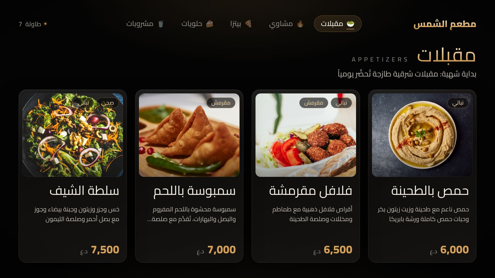 | 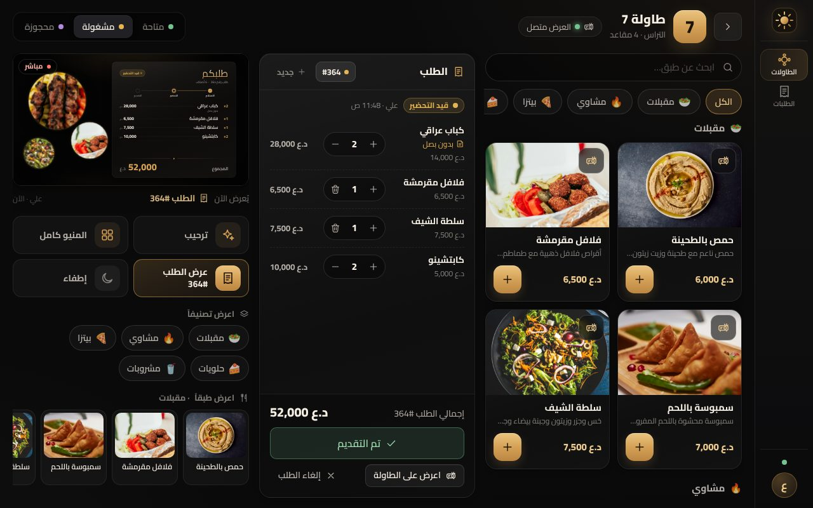 |

**الجزء الأول لصاحب المطعم** (بدون مصطلحات تقنية)، و**الجزء الثاني للمطوّرين والفنيين**.

### المحتويات

**الجزء الأول — لصاحب المطعم**
1. [ما هو النظام؟](#1-ما-هو-النظام)
2. [الأدوار والصلاحيات](#2-الأدوار-والصلاحيات)
3. [ماذا تشتري؟](#3-ماذا-تشتري)
4. [التركيب خطوة بخطوة](#4-التركيب-خطوة-بخطوة)
5. [الاستخدام اليومي](#5-الاستخدام-اليومي)
6. [مشاكل شائعة وحلولها](#6-مشاكل-شائعة-وحلولها)

**الجزء الثاني — القسم التقني**

7. [المعمارية](#7-المعمارية)
8. [التقنيات وهيكل المشروع](#8-التقنيات-وهيكل-المشروع)
9. [نموذج البيانات](#9-نموذج-البيانات)
10. [ملخص واجهة البرمجة (API)](#10-ملخص-واجهة-البرمجة-api)
11. [الأحداث الحية (Socket.IO)](#11-الأحداث-الحية-socketio)
12. [صفحة جهاز العرض](#12-صفحة-جهاز-العرض)
13. [تطبيق أندرويد](#13-تطبيق-أندرويد)
14. [التطوير والاختبارات](#14-التطوير-والاختبارات)
15. [ملاحظات الأمان](#15-ملاحظات-الأمان)
16. [قائمة التحقق قبل التشغيل الفعلي](#16-قائمة-التحقق-قبل-التشغيل-الفعلي)
17. [الترقية من الإصدار الأول](#17-الترقية-من-الإصدار-الأول)
18. [المصادر والتراخيص](#18-المصادر-والتراخيص)

---

# الجزء الأول — لصاحب المطعم

## 1. ما هو النظام؟

المطعم مقسّم إلى **أقسام** (مثل: الصالة الرئيسية، التراس، VIP). في كل قسم طاولات مرقّمة، وفوق كل طاولة جهاز عرض واحد عادةً.

يتكوّن النظام من ثلاثة أشياء:

1. **كمبيوتر صغير في المطعم (الخادم).** يحفظ المنيو والصور والطلبات، ويوصل الأوامر إلى أجهزة العرض. يعمل داخل شبكة الواي فاي الخاصة بالمطعم ولا يحتاج إنترنت.
2. **جهاز عرض فوق كل طاولة.** بروجكتر في السقف موصول بجهاز Android TV صغير (أو كمبيوتر صغير). يعرض على سطح الطاولة شاشة ترحيب، أو المنيو كاملاً، أو تصنيفاً واحداً، أو طبقاً بصورته الكبيرة، أو ملخص طلب الطاولة.
3. **تطبيق الموظفين.** نفس التطبيق للجميع على التابلت أو الجوال أو الكمبيوتر، وكل شخص يرى ما يسمح به دوره.

**كيف يعمل في الصالة:** يحمل الويتر التابلت ويضغط رقم الطاولة. يختار ما يُعرض عليها، مثلاً «المنيو كامل» أو تصنيف «مشاوي» أو طبقاً معيّناً، فيظهر على الطاولة خلال أقل من ثانية. بعدها يسجّل الطلب من نفس الشاشة ويرسله. يستطيع أيضاً عرض ملخص الطلب على الطاولة ليراه الضيوف، ويتحدّث الملخص وحده عندما تتغير حالة الطلب (قيد التحضير، تم التقديم...).

| ترحيب | تصنيف كامل |
|---|---|
|  |  |
| **طبق واحد بصورته أو الفيديو الخاص به** | **ملخص طلب الطاولة** |
|  | 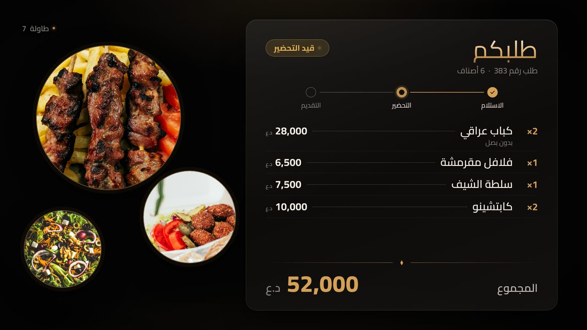 |

> الخلفيات داكنة عن قصد: **الأسود يعني أن البروجكتر لا يُسقط ضوءاً**، فيبقى سطح الطاولة هادئاً وتبرز الصور والنصوص فقط.

## 2. الأدوار والصلاحيات

لكل موظف حساب باسم مستخدم وكلمة مرور، ولكل حساب دور واحد. **الخادم نفسه يمنع أي عملية خارج الدور**، وليس التطبيق فقط.

| | المالك | المصمم | الويتر |
|---|:---:|:---:|:---:|
| رؤية الطاولات والتحكم بما يُعرض عليها | ✅ | ✅ (للتجربة) | ✅ |
| تسجيل الطلبات وتغيير حالتها | ✅ | — | ✅ |
| تغيير حالة الطاولة (متاحة / مشغولة / محجوزة) | ✅ | — | ✅ |
| مكتبة الصور والفيديو (رفع، تسمية، حذف) | ✅ | ✅ | — |
| محتوى المنيو: الأطباق والتصنيفات والصور والأوصاف والترتيب والإظهار | ✅ | ✅ | قراءة فقط |
| **الأسعار** | ✅ | ❌ (يظهر له السعر للقراءة فقط) | — |
| تصميم العرض (الألوان، النمط، الخط، الخلفية) | ✅ | ✅ | — |
| معايرة أجهزة العرض وشاشة الاختبار | ✅ | ✅ | — |
| الأقسام والطاولات وأجهزة العرض وربطها | ✅ | — | — |
| المستخدمون، الإعدادات العامة، التقارير، سجل النشاط | ✅ | — | — |

## 3. ماذا تشتري؟

| الجهاز | العدد | المواصفات المقترحة |
|---|---|---|
| **كمبيوتر الخادم** | 1 للمطعم | كمبيوتر صغير (Mini-PC) بمعالج Intel N100 أو Core i3، ذاكرة 8 GB، قرص SSD بسعة 256 GB، ومنفذ شبكة سلكي. يعمل بنظام Linux (Ubuntu أو Debian، وهو الأنسب) أو Windows. يكفي Raspberry Pi 5 (8 GB) لمطعم صغير. |
| **بروجكتر** | 1 لكل طاولة | ليزر بدقة 1080p، سطوع 3000 إلى 5000 لومن (حسب إضاءة الصالة)، قصير المدى (Short-throw) إذا كان السقف منخفضاً. يُفضَّل أن يدعم **PJLink** (منفذ شبكة) لتشغيله وإطفائه من التطبيق. |
| **جهاز تشغيل لكل بروجكتر** | 1 لكل بروجكتر | صندوق **Android TV** بنظام Android 9 أو أحدث، ذاكرة 2 إلى 4 GB، ويفضّل بمنفذ Ethernet، يوصل بالبروجكتر عبر HDMI. البديل: بروجكتر بنظام أندرويد مدمج، أو كمبيوتر صغير بمتصفح Chromium. |
| **تابلت الويتر** | 2 إلى 4 للمطعم كله | تابلت أندرويد بشاشة 10 إنش ودقة 1280×800 أو أعلى، بنظام Android 9 أو أحدث. يمكن أيضاً استخدام أي تابلت أو جوال بمتصفح Chrome حديث. |
| **كمبيوتر أو لابتوب** | حسب الحاجة | للمالك والمصمم: لرفع الصور وتعديل المنيو والتقارير (أي متصفح Chrome أو Edge). |
| **الشبكة** | — | راوتر جيد مع نقاط وصول تغطي الصالة. وصّل الخادم وصناديق العرض بالكابل إن أمكن. اجعل شبكة أجهزة المطعم منفصلة عن واي فاي الزبائن. |

**نصائح للطاولة والإضاءة:**
- سطح الطاولة **مطفي (Matte) بلون فاتح أو خشبي متوسط**. السطح اللامع يعكس بقعة ضوء في عين الجالسين.
- ركّب البروجكتر فوق منتصف الطاولة. أي ميلان بسيط تصحّحه **المعايرة** من التطبيق، فلا داعي لتركيب مثالي.
- خفّف الإضاءة المباشرة فوق الطاولات، واستخدم إضاءة جانبية دافئة.
- طاولة يجلس الضيوف على جانبيها الطويلين؟ اختر تخطيط «جهتين» لجهاز العرض، فيظهر المنيو مرتين ويكون كل نصف مقروءاً من جهته:


## 4. التركيب خطوة بخطوة

### 4.1 تشغيل الخادم

يكفي فعل هذا مرة واحدة على كمبيوتر الخادم، ويمكن أن يقوم به أي فني.

1. ثبّت **Node.js الإصدار 22** من [nodejs.org](https://nodejs.org).
2. انسخ مجلد `projection-menu` إلى الكمبيوتر، ثم افتح نافذة الأوامر داخله وثبّت المكتبات:
   ```bash
   npm ci
   ```
3. اختر طريقة البداية:
   - **مع مطعم تجريبي جاهز** (منيو بخمسة تصنيفات و20 طبقاً بصور حقيقية، ثلاثة أقسام، 12 طاولة، حسابات تجريبية):
     ```bash
     npm run seed
     ```
   - **أو من الصفر**: تخطَّ هذه الخطوة. أول من يفتح التطبيق يُطلب منه إنشاء حساب المالك.
4. شغّل الخادم:
   ```bash
   npm start
   ```
   تظهر عناوين مثل `http://192.168.1.10:3000/app/`، وهذا هو عنوان تطبيق الموظفين على شبكة المطعم.
5. **اجعل عنوان الخادم ثابتاً**: من إعدادات الراوتر احجز له نفس عنوان IP دائماً (DHCP Reservation)، حتى لا تفقد الأجهزة الاتصال به بعد إعادة التشغيل.
6. ليعمل الخادم وحده عند تشغيل الكمبيوتر على Linux، يوجد ملف خدمة جاهز: [`deploy/projection-menu.service`](deploy/projection-menu.service) (التفاصيل في [القسم 16](#16-قائمة-التحقق-قبل-التشغيل-الفعلي)).

الحسابات التجريبية التي ينشئها `npm run seed`، **وغيّر كلمات مرورها فوراً**:

| الدور | اسم المستخدم | كلمة المرور |
|---|---|---|
| المالك | `owner` | `owner1234` |
| المصمم | `designer` | `design1234` |
| ويتر (علي) | `waiter1` | `1111` |
| ويتر (حسن) | `waiter2` | `2222` |

### 4.2 أول دخول وتجهيز المطعم (المالك)

افتح `http://<عنوان الخادم>:3000/app/` من أي جهاز على شبكة المطعم وسجّل الدخول بحساب المالك.

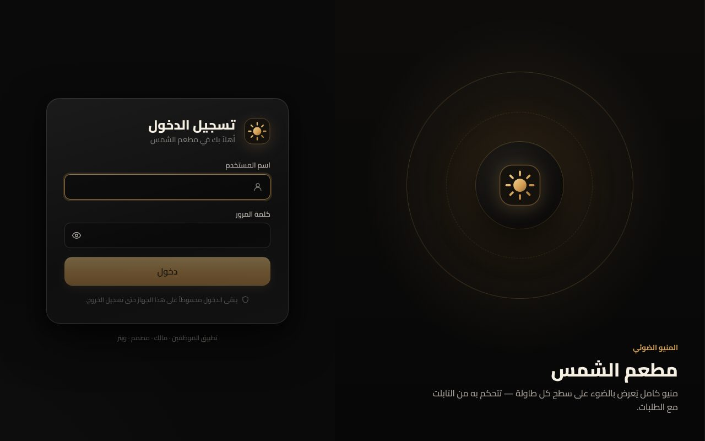

1. **الإعدادات**: اسم المطعم بالعربي والإنجليزي، الشعار، العملة (د.ع افتراضياً)، ونص الترحيب الذي يظهر على الطاولات.
2. **الأقسام والطاولات**: أنشئ الأقسام، ثم الطاولات بأرقامها وعدد مقاعدها. زر «إضافة عدة طاولات» يضيف مجموعة أرقام دفعة واحدة.
3. **المستخدمون**: أنشئ حساباً لكل ويتر ومصمم.
4. **المنيو**: أضف التصنيفات والأطباق (أو اترك هذا للمصمم)، ثم ضع الأسعار من تبويب «الأسعار».

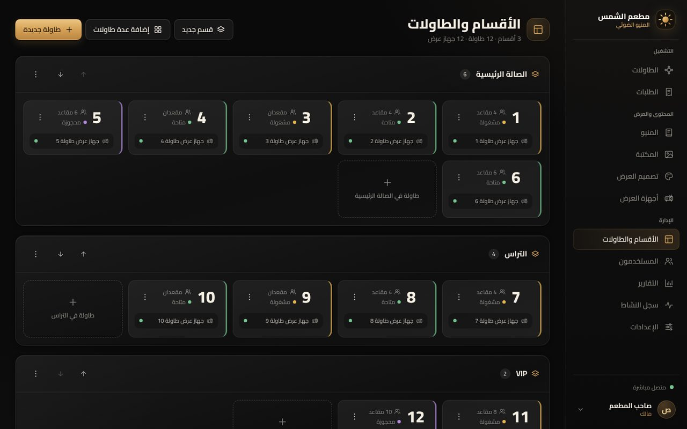

### 4.3 تركيب أجهزة العرض (Android TV)

لكل طاولة: البروجكتر في السقف، وصندوق Android TV موصول به عبر HDMI ومتصل بشبكة المطعم.

**1) تثبيت التطبيق على الصندوق**
- افتح متصفح الصندوق على العنوان `http://<عنوان الخادم>:3000/app.apk` لتنزيل تطبيق «المنيو الضوئي». يظهر هذا العنوان كرمز QR في **الإعدادات** وفي نافذة ربط الجهاز، فيمكنك أيضاً مسحه بجوال ونقل الملف.
- اسمح بتثبيت التطبيقات من «مصادر غير معروفة» عندما يطلب أندرويد ذلك، ثم ثبّت التطبيق.

**2) إعداد الصندوق.** عند أول تشغيل يسأل التطبيق «ما دور هذا الجهاز؟». اختر **جهاز عرض على طاولة**.

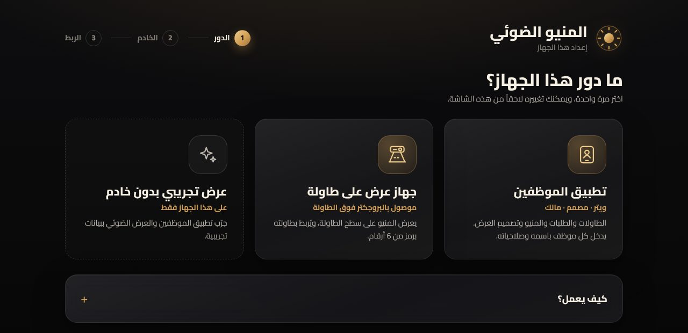

**3) اختيار الخادم.** يبحث التطبيق في الشبكة ويعرض خادم المطعم باسمه، فاضغط عليه. إن لم يظهر، اكتب العنوان يدوياً (مثل `192.168.1.10:3000`) أو امسح رمز QR.

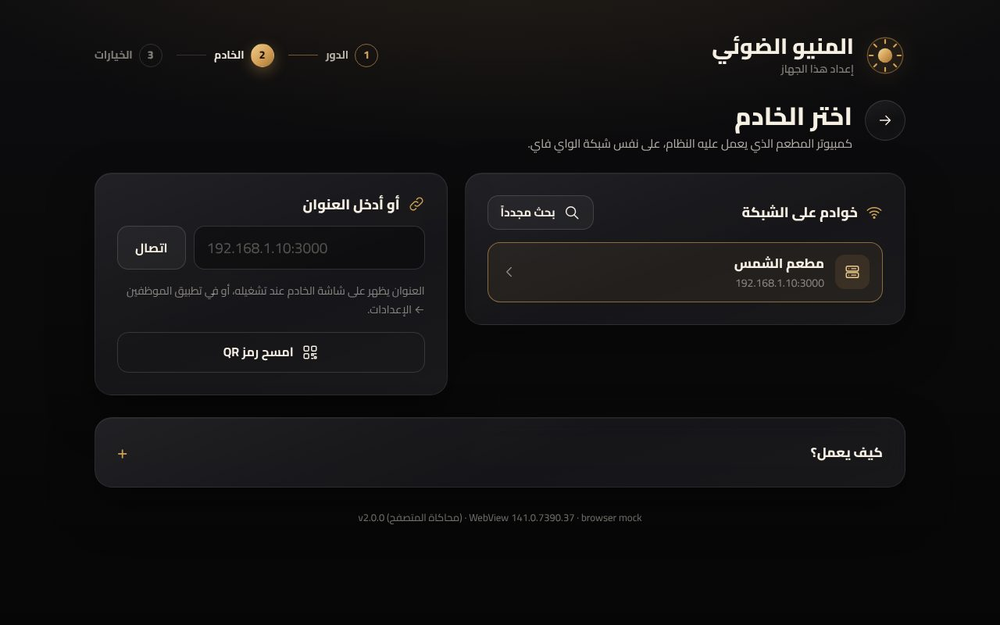

**4) رمز الربط.** في تطبيق الموظفين، يفتح المالك **الأقسام والطاولات** ويضغط «ربط جهاز عرض» على الطاولة (أو من **أجهزة العرض** ← «ربط جهاز برمز»). يظهر رمز من 6 أرقام صالح لمدة 10 دقائق ولمرة واحدة.

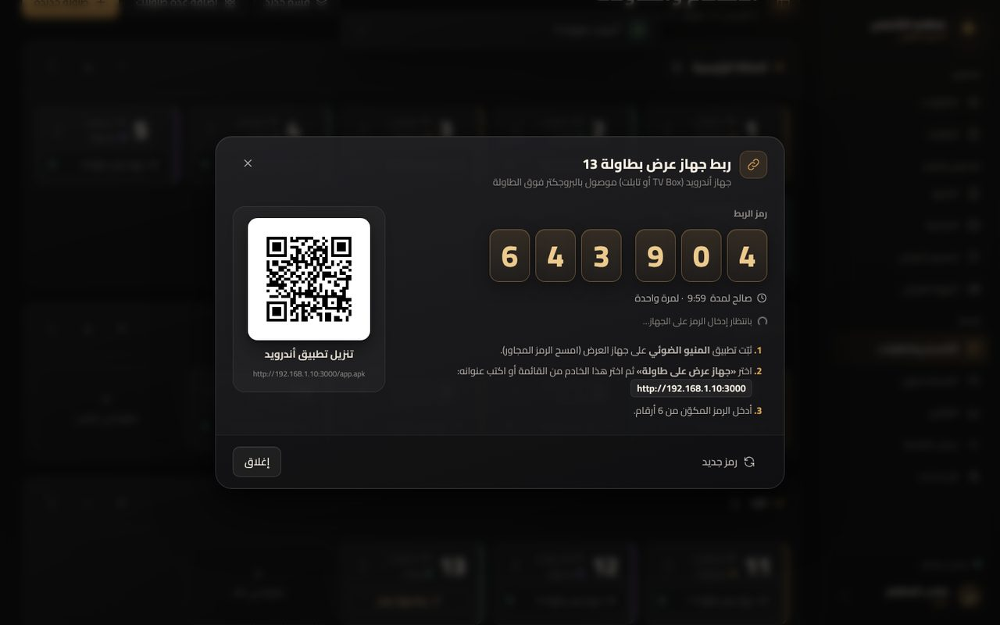

أدخل الرمز على الصندوق بالريموت واضغط «ربط وتشغيل». يرتبط الجهاز بالطاولة ويبدأ العرض فوراً، وتتحول نافذة الربط عند المالك إلى «تم الربط» وحدها.

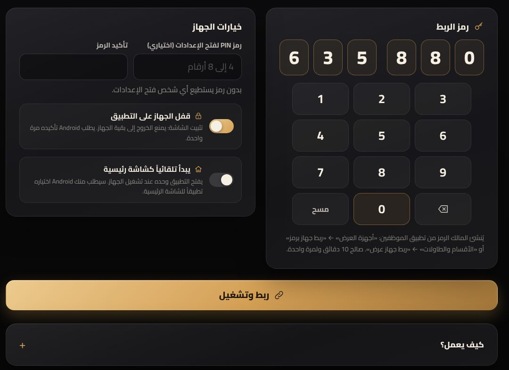

خيارات مفيدة في نفس الصفحة:
- **قفل الجهاز على التطبيق**: يمنع الخروج إلى بقية الصندوق.
- **يبدأ تلقائياً كشاشة رئيسية**: يفتح التطبيق وحده بعد انقطاع الكهرباء.
- **رمز PIN** (4 إلى 8 أرقام): يُطلب قبل فتح إعدادات الجهاز.

> **بديل بدون أندرويد:** كمبيوتر صغير بمتصفح Chromium موصول بالبروجكتر. انسخ «رابط المشغل» من **أجهزة العرض** وشغّل [`deploy/kiosk-player.sh`](deploy/kiosk-player.sh) عند الإقلاع. يفتح السكربت الرابط بملء الشاشة، وينتظر حتى يعمل الخادم بعد انقطاع الكهرباء.

### 4.4 المعايرة: جعل الصورة تنطبق على الطاولة

يفعلها المالك أو المصمم مرة واحدة لكل جهاز، ويُستحسن أن يكون أحدهما قرب الطاولة.

1. افتح **أجهزة العرض** ← «معايرة» على جهاز الطاولة.
2. تظهر على الطاولة **شاشة اختبار** فيها شبكة وزوايا مرقّمة من 1 إلى 4.
3. اسحب الزوايا الأربع في التطبيق (أو حرّكها بالأسهم) حتى تنطبق كل زاوية مرقّمة على زاوية الطاولة الحقيقية. كل حركة تظهر على الطاولة مباشرة وتُحفظ وحدها.
4. اضغط «تم». من نفس الصفحة تضبط أيضاً تدوير الصورة (0 أو 90 أو 180 أو 270 درجة) والتخطيط (جهة واحدة أو جهتين)، وعنوان البروجكتر لتشغيله وإطفائه عن بُعد (PJLink).

| في التطبيق | على الطاولة |
|---|---|
| 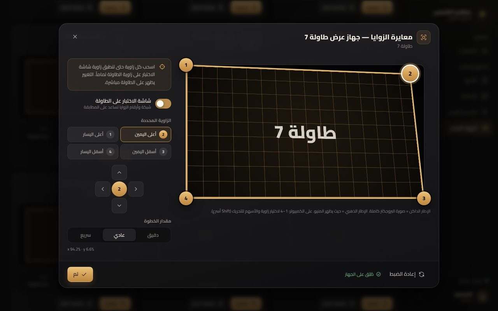 | 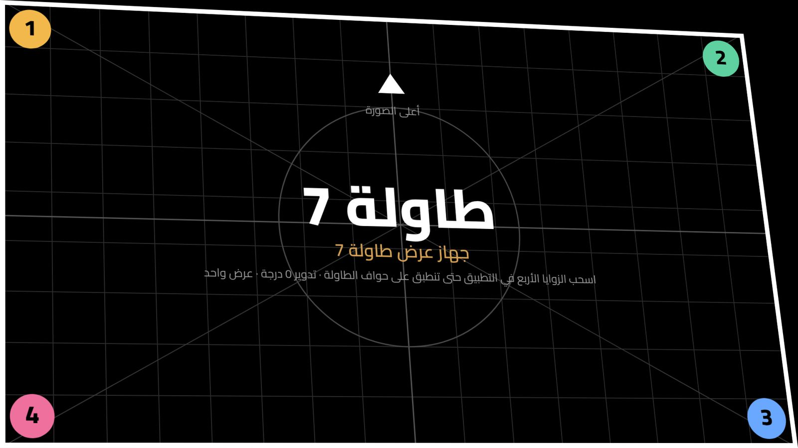 |

### 4.5 تابلتات الويتر

- ثبّت نفس التطبيق من `http://<عنوان الخادم>:3000/app.apk`، واختر **تطبيق الموظفين (ويتر / مصمم / مالك)**، ثم اختر الخادم.
- يكفي أيضاً فتح `http://<عنوان الخادم>:3000/app/` في متصفح Chrome على أي تابلت أو جوال.
- يسجّل كل ويتر الدخول بحسابه، ويبقى الدخول محفوظاً على الجهاز حتى يضغط «تسجيل الخروج».

### 4.6 العرض التجريبي (بدون خادم)

لتجربة النظام أو عرضه على شخص قبل الشراء: ثبّت التطبيق على أي جهاز أندرويد واختر **عرض تجريبي بدون خادم**. يعمل تطبيق الموظفين الحقيقي بجانب طاولة يظهر عليها الإسقاط، ويمكنك التنقل بين أدوار الويتر والمصمم والمالك. كل ما تغيّره في العرض التجريبي يبقى في الجهاز ويُنسى عند الخروج.

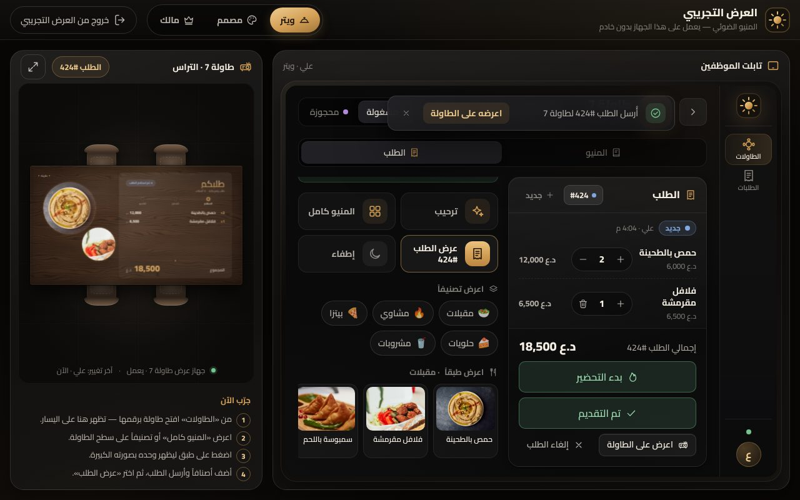

## 5. الاستخدام اليومي

### الويتر

1. **الطاولات**: كل الطاولات مقسّمة حسب الأقسام. يظهر على كل بطاقة رقم الطاولة وحالتها بلونها (متاحة / مشغولة / محجوزة)، ونقطة اتصال جهاز العرض، وما يُعرض عليها الآن، ومبلغ طلبها الحالي. يمكن الوصول إلى طاولة بسرعة بكتابة رقمها.

   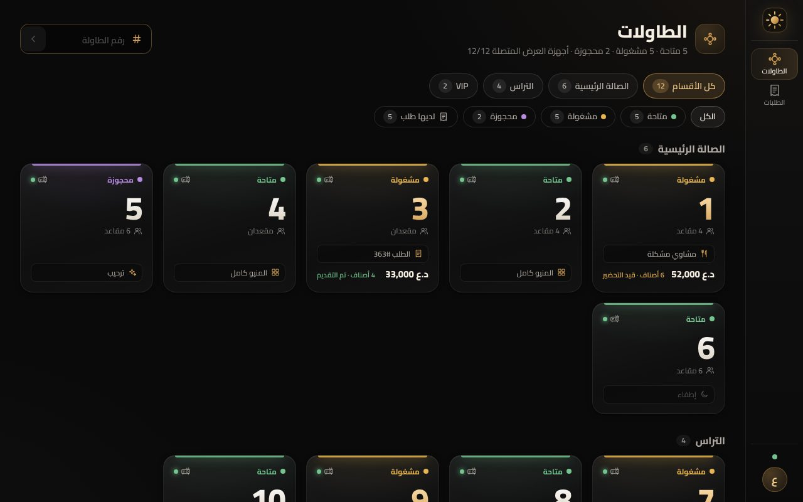

2. **شاشة الطاولة**:
   - **على اليمين: المنيو والطلب.** ابحث عن طبق أو اختر تصنيفاً، واضغط **+** لإضافته، وعدّل الكمية أو أضف ملاحظة (مثل «بدون بصل»). اضغط «إرسال الطلب»، أو «إضافة إلى الطلب» إذا كان للطاولة طلب مفتوح.
   - **على اليسار: معاينة حيّة** لما على الطاولة الآن، وتحتها أزرار العرض: «ترحيب»، «المنيو كامل»، تصنيف معيّن، طبق معيّن، «عرض الطلب»، «إطفاء».
   - بعد كل تغيير تظهر رسالة «ظهر على الطاولة» عندما يؤكد جهاز العرض استلامه.
3. **حالة الطلب**: «بدء التحضير» ← «تم التقديم» ← «تم الدفع». يمكن إلغاء الطلب قبل التقديم. عند إرسال أول طلب تصبح الطاولة «مشغولة»، وعند دفع آخر طلب أو إلغائه تعود «متاحة».
4. **الطلبات**: كل الطلبات النشطة في الصالة مرتبة حسب حالتها.

   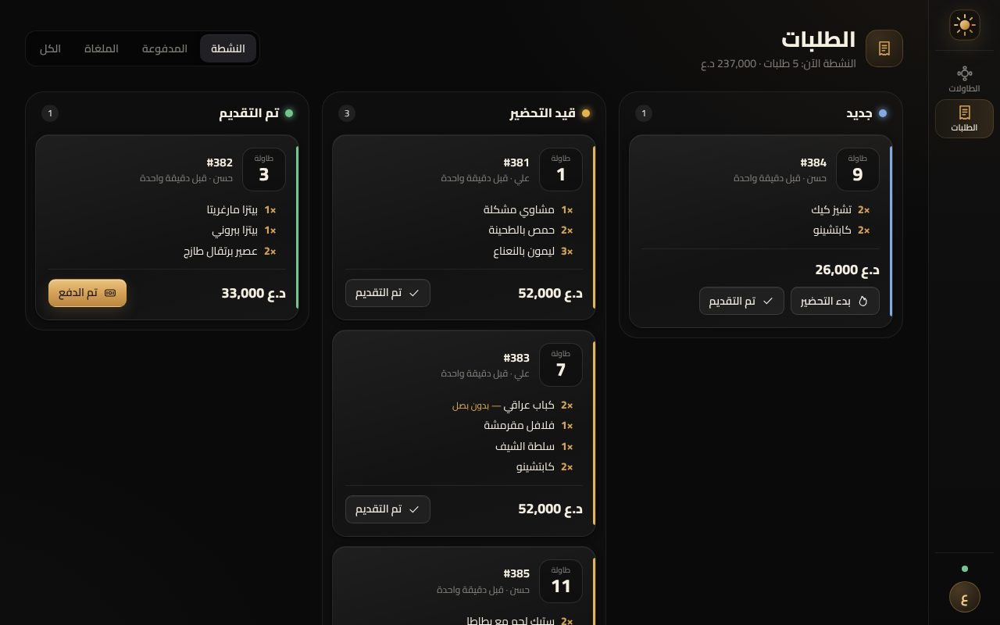

5. كل شيء يتحدّث مباشرة بين الأجهزة. إذا غيّر زميل ما يُعرض على طاولة يظهر التغيير عندك فوراً، ويظهر لك تنبيه عند كل طلب جديد.

على الجوال يعمل التطبيق نفسه بتبويبات «العرض / المنيو / الطلب»:

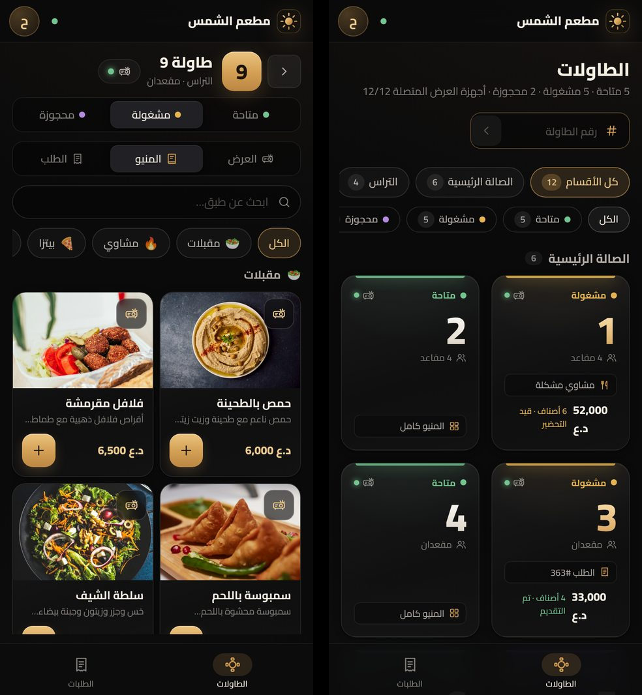

### المصمم

- **المكتبة**: اسحب الصور والفيديوهات إلى الصفحة لرفعها (عدة ملفات معاً، مع شريط تقدم لكل ملف). الأنواع المقبولة: JPG وPNG وWebP للصور، MP4 وWebM للفيديو، وGLB للمجسمات ثلاثية الأبعاد. لا يمكن حذف ملف مستخدم في طبق أو تصنيف أو في التصميم، ويخبرك التطبيق أين هو مستخدم.

  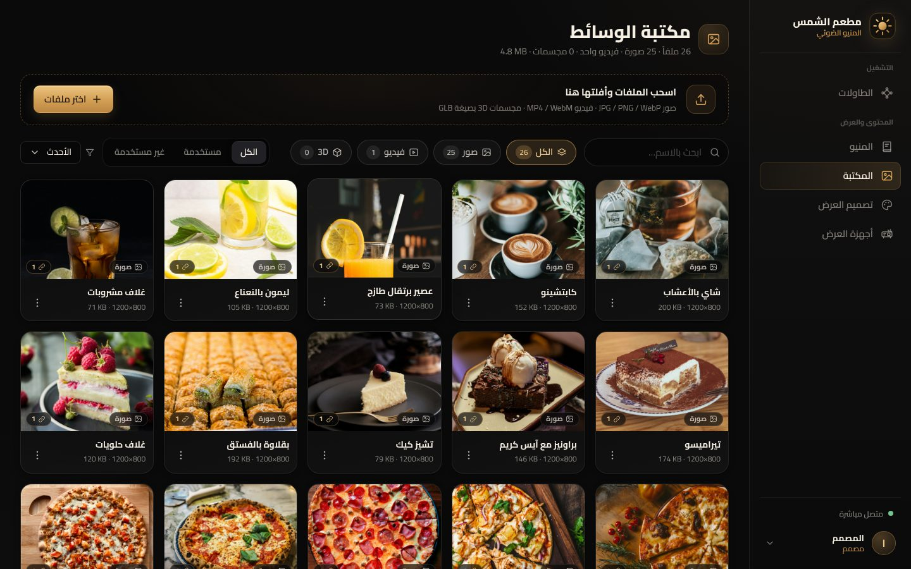

- **المنيو**: رتّب التصنيفات والأطباق بالسحب أو بالأسهم، وأظهر وأخفِ التصنيفات، واجعل الطبق «غير متوفر» مؤقتاً أو «مميزاً» بنجمة. نافذة الطبق فيها الاسم والوصف والصورة والفيديو والمجسم والشارات («الأكثر طلباً»، «حار»، «نباتي»...) والسعرات ووقت التحضير. السعر يظهر للمصمم لكنه لا يستطيع تعديله.

  | قائمة الأطباق | تعديل طبق |
  |---|---|
  | 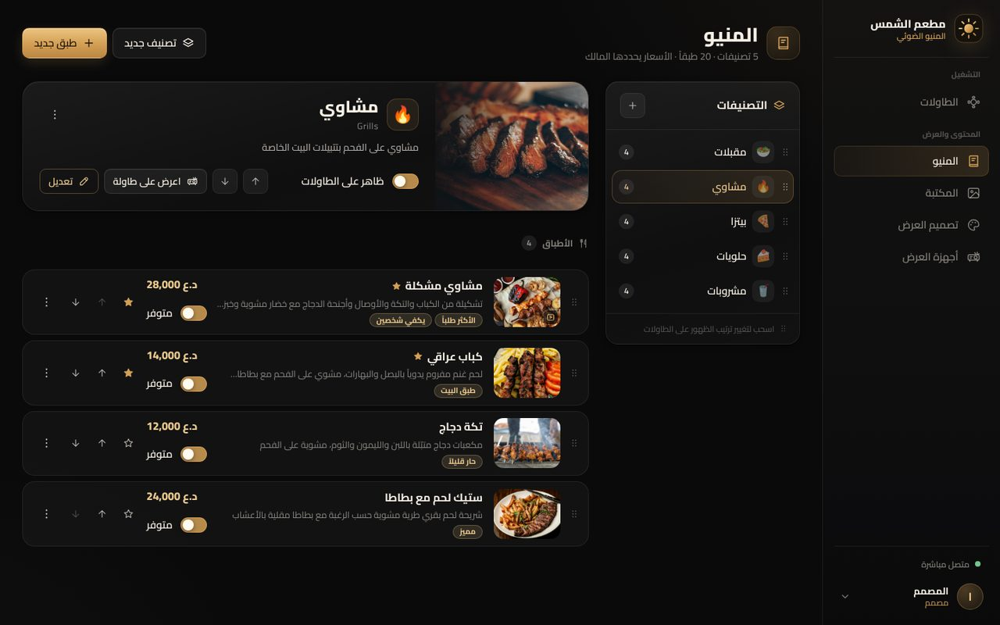 | 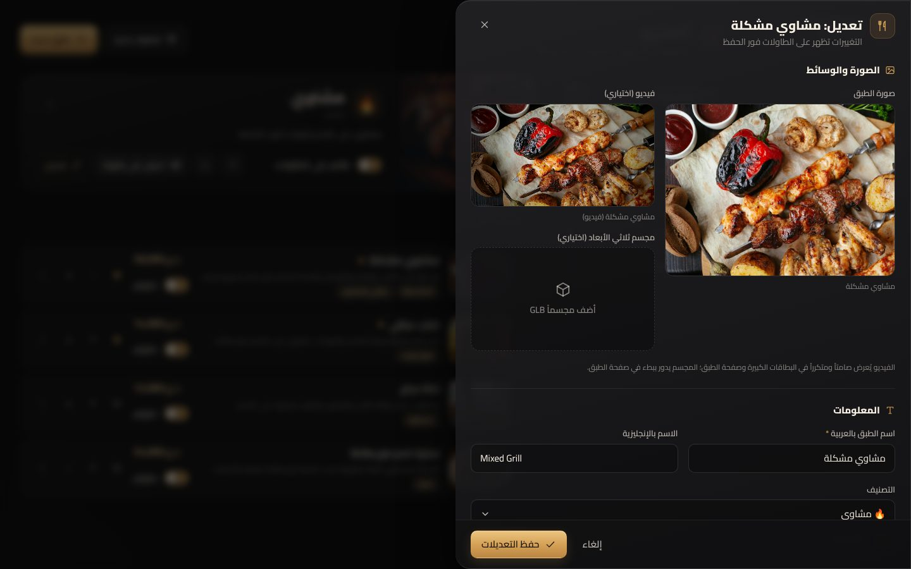 |

- **تصميم العرض**: أربعة أنماط (نوار، رخام، حديقة، ملكي)، ولون التمييز، والخلفية (صورة أو فيديو من المكتبة)، والخط (Cairo أو Tajawal)، وشكل البطاقات (زجاجي أو صلب)، وإظهار الأسعار والأوصاف والسعرات، ومدة كل صفحة. تظهر المعاينة الحية على اليسار قبل الحفظ، ولا تتغير الطاولات إلا بعد «حفظ وتطبيق على كل الطاولات».

  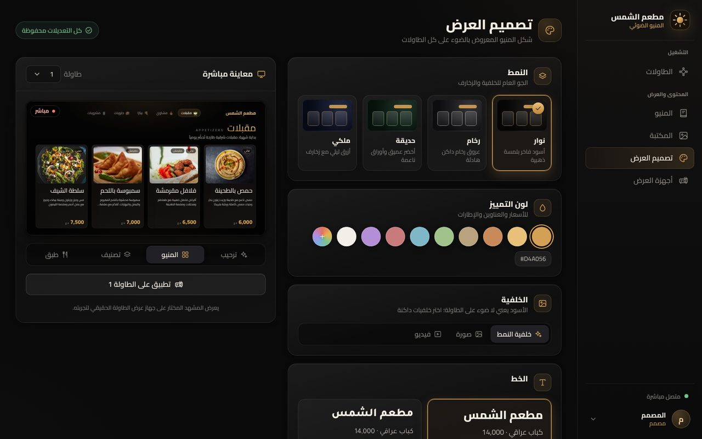

  

- **أجهزة العرض**: المعايرة وشاشة الاختبار (القسم 4.4). يستطيع المصمم أيضاً عرض أي طبق على أي طاولة لتجربته.

### المالك

كل ما سبق، إضافة إلى:

- **الأسعار**: لوحة تعرض كل الأطباق. اكتب السعر واضغط Enter فيظهر على الطاولات فوراً.

  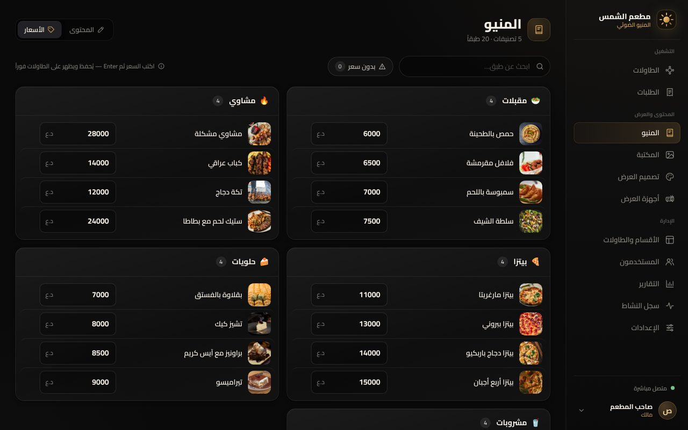

- **المستخدمون**: إنشاء حسابات، وتغيير الدور، و«إعادة تعيين كلمة المرور»، و«تعطيل الحساب» (يُخرج الموظف من كل أجهزته فوراً).

  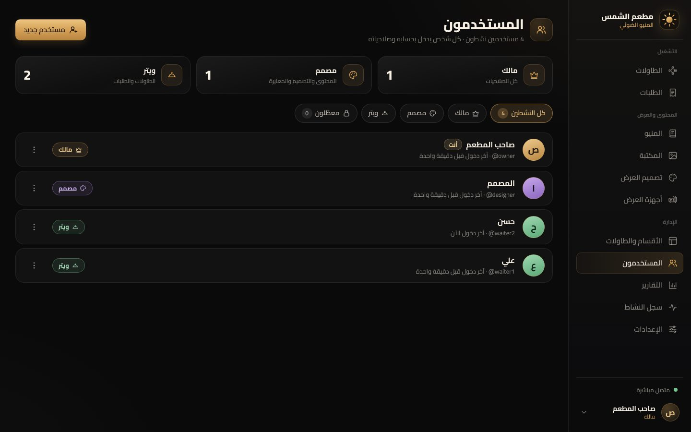

- **أجهزة العرض**: حالة اتصال كل جهاز، والتدوير، والتخطيط، وتشغيل البروجكتر وإطفاؤه (PJLink)، و«تغيير المفتاح» لجهاز مفقود (يتوقف الجهاز القديم فوراً ويجب ربطه من جديد).

  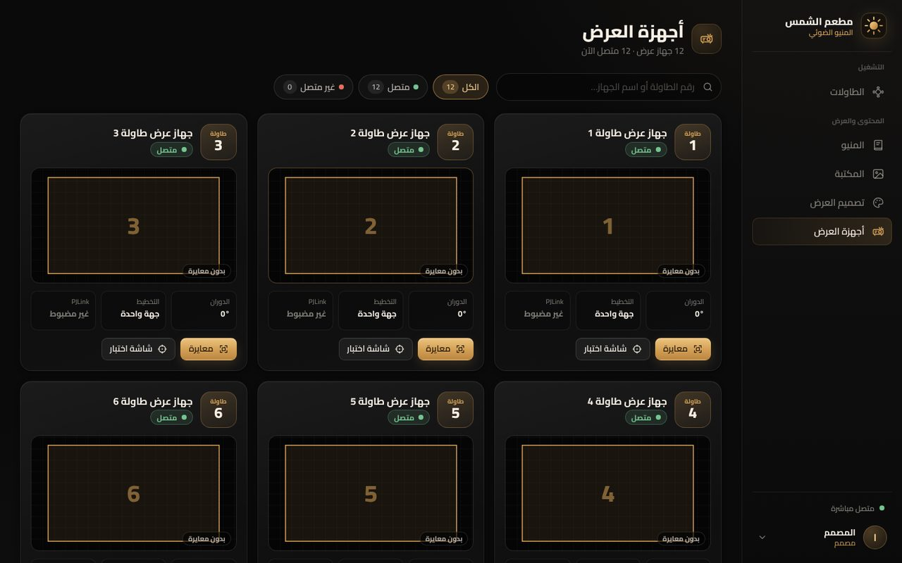

- **التقارير**: الإيرادات وعدد الطلبات ومتوسط الفاتورة وأفضل يوم، ورسم للإيرادات اليومية، والأطباق الأكثر طلباً، ومبيعات كل ويتر. تُحسب الطلبات «المقدّمة» و«المدفوعة».

  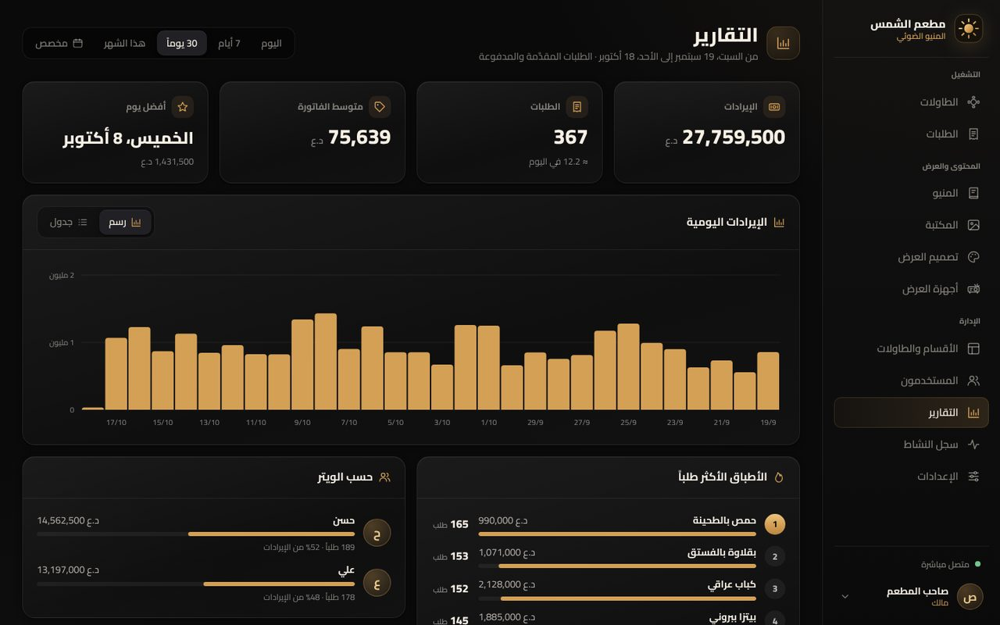

- **الإعدادات**: هوية المطعم وشاشة الترحيب، وعناوين الخادم ورموز QR لتطبيق الموظفين وتنزيل تطبيق أندرويد.

  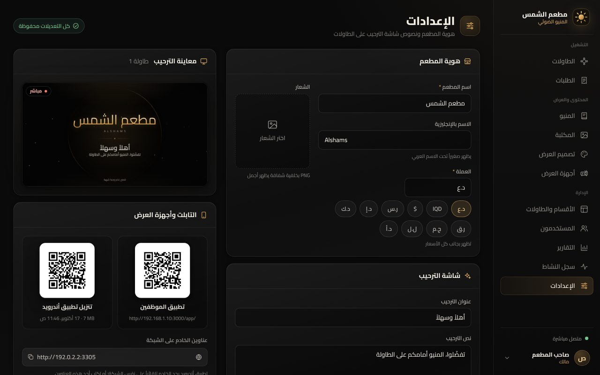

- **سجل النشاط**: من غيّر سعراً، ومن أضاف موظفاً أو جهازاً، ومن غيّر حالة طلب، ومتى.

  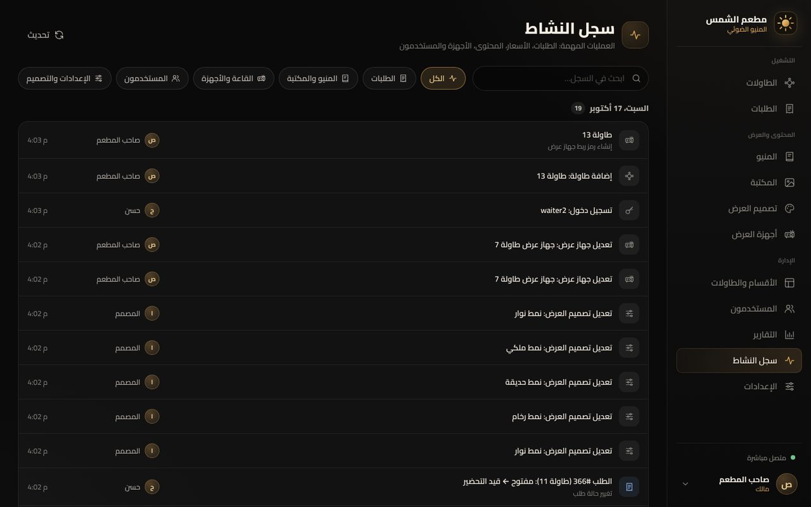

## 6. مشاكل شائعة وحلولها

| المشكلة | الحل |
|---|---|
| نقطة جهاز العرض حمراء («غير متصل») | تأكد أن الصندوق يعمل ومتصل بشبكة المطعم، وأن الخادم يعمل. التطبيق يعيد الاتصال وحده، ويبقى آخر ما عُرض ظاهراً أثناء الانقطاع. |
| الصورة مائلة أو أكبر من الطاولة | أعد المعايرة (القسم 4.4). |
| النص مقلوب للضيوف | غيّر «التدوير» إلى 180 درجة من إعدادات الجهاز، أو استخدم تخطيط «جهتين». |
| الخادم لا يظهر في بحث الصندوق | اكتب العنوان يدوياً. بعض الراوترات تمنع البحث في الشبكة (mDNS). |
| نسي موظف كلمة المرور | المالك ← المستخدمون ← «إعادة تعيين كلمة المرور». |
| ضاع تابلت أو صندوق عرض | عطّل حساب الموظف، أو اضغط «تغيير المفتاح» لجهاز العرض. |
| أريد فتح إعدادات الصندوق المقفل | اضغط 5 مرات بسرعة في الزاوية العلوية اليسرى، أو زر الرجوع 3 مرات، أو زر MENU في الريموت. يُطلب رمز PIN إن كان مضبوطاً. |
| بعد التحديث يقول الخادم إن قاعدة البيانات قديمة | راجع [الترقية من الإصدار الأول](#17-الترقية-من-الإصدار-الأول). |

---

# الجزء الثاني — القسم التقني

## 7. المعمارية

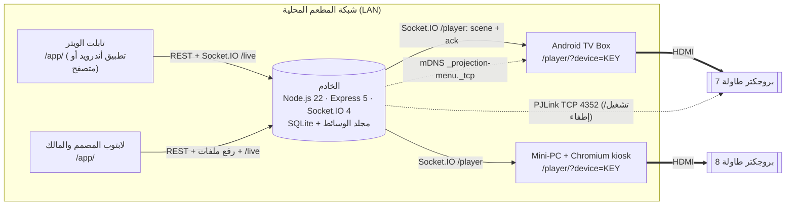

**الفكرة الأساسية:** البروجكتر مجرد شاشة. الصفحة التي ترسم المنيو تعمل على الجهاز الموصول به (صفحة `/player/` في WebView أو Chromium)، ويرسل الخادم لها **مشهداً** (scene) يصف ما يُعرض فقط، ولا يرسل صوراً جاهزة. لكل طاولة مشهد واحد محفوظ في `table_scenes`، فإذا أُعيد تشغيل الجهاز يعود إليه.

### تسلسل تغيير المشهد

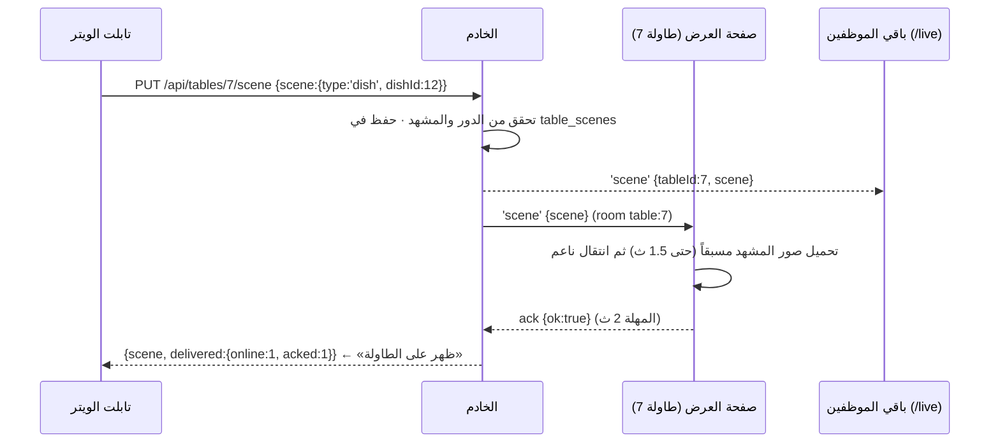

### تسلسل ربط جهاز عرض برمز

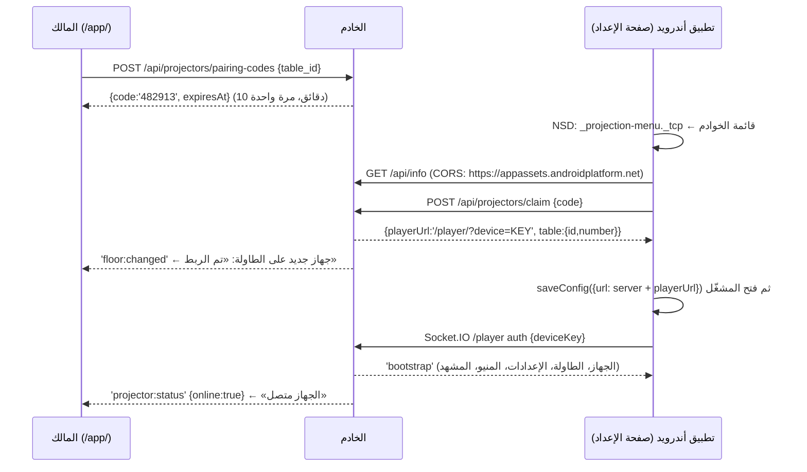

## 8. التقنيات وهيكل المشروع

- **الخادم:** Node.js 22 (ESM)، Express 5، Socket.IO 4، better-sqlite3 (WAL)، multer 2 لرفع الملفات، bonjour-service لإعلان mDNS. ffprobe اختياري لقراءة أبعاد الفيديو ومدته.
- **الواجهات:** Preact 10 و htm **بدون أي خطوة بناء** (import map يشير إلى `/vendor/...`)، و three.js لمجسمات `.glb` (يُحمَّل فقط عند الحاجة)، و qrcode-generator لرموز QR. كل المكتبات والخطوط (Cairo وTajawal بصيغة woff2) تُخدَم من الخادم نفسه، فالنظام لا يحتاج إنترنت.
- **أندرويد:** Kotlin، WebView مع WebViewAssetLoader، Android NSD، وkiosk عبر Lock Task. لا تقنيات أصلية أخرى.

```
projection-menu/
├─ src/                      الخادم
│  ├─ server.js              التشغيل وإعلان mDNS
│  ├─ app.js                 Express وSocket.IO وربط الخدمات (قابل للاختبار بدون listen)
│  ├─ sockets.js             مساحتا /live (الموظفون) و /player (أجهزة العرض)
│  ├─ config.js              الإعدادات من متغيرات البيئة
│  ├─ auth/                  الجلسات (pm_session) وصلاحيات الأدوار
│  ├─ routes/                auth, floor, projectors, menu, media, settings, scenes, orders, reports, player, system
│  ├─ services/              projectionService (المشاهد والتسليم)، orders، menu، floor، media، settings، live، mdns، pjlink، activity
│  ├─ lib/                   كلمات المرور (scrypt)، الكوكيز، حد المحاولات، التحقق، المعايرة، عناوين الشبكة
│  └─ db/                    schema.sql، الاتصال، seed، تحميل sample-content
├─ public/
│  ├─ app/                   تطبيق الموظفين (SPA بالتوجيه عبر #)
│  │  └─ lib/api.js, lib/live.js   كل اتصال بالشبكة يمر من هذين الملفين فقط
│  ├─ player/                صفحة جهاز العرض (المشاهد، الأنماط، المعايرة، شاشة الاختبار)
│  └─ shared/                fonts/، fonts.css، tokens.css، homography.js
├─ sample-content/           المطعم التجريبي: manifest.json + images/ + CREDITS.md
├─ android/                  تطبيق أندرويد + العرض التجريبي (assets/demo) + tools/make-demo-content.mjs
├─ deploy/                   projection-menu.service (systemd) و kiosk-player.sh (Chromium)
├─ dist/ProjectionMenu.apk   نسخة release موقّعة يقدّمها الخادم على /app.apk
├─ docs/screenshots/
└─ test/                     اختبارات node:test (الخادم + تطابق أصول أندرويد)
```

## 9. نموذج البيانات

SQLite في `data/menu.db`، والملفات المرفوعة في `data/media/` بأسماء عشوائية لا تتغير. المخطط الكامل في [`src/db/schema.sql`](src/db/schema.sql).

| الجدول | المحتوى |
|---|---|
| `users` | الاسم، اسم المستخدم (فريد، بدون حساسية لحالة الأحرف)، `password_hash` (scrypt مع ملح)، `role` ∈ owner/designer/waiter، `is_active`، آخر دخول |
| `sessions` | `token_hash` (sha256 للتوكن)، المستخدم، تاريخ الانتهاء (30 يوماً تتجدد مع الاستخدام)، user agent |
| `areas` · `restaurant_tables` | الأقسام، والطاولات (`number` فريد، المقاعد، `status` ∈ free/occupied/reserved، الترتيب) |
| `projectors` | الطاولة، الاسم، `device_key` (فريد)، `calibration` `{corners:[[x,y]×4]}` (TL, TR, BR, BL بإحداثيات من 0 إلى 1)، `rotation` ∈ 0/90/180/270، `layout` ∈ single/dual، إعدادات PJLink، آخر ظهور |
| `pairing_codes` | رمز من 6 أرقام، الطاولة، الاسم المقترح، صالح 10 دقائق ولمرة واحدة |
| `media_assets` | النوع image/video/model3d، العنوان، اسم الملف، النوع، الحجم، sha256، الأبعاد، المدة، من رفعه |
| `categories` · `dishes` | المحتوى بالعربية والإنجليزية، الغلاف والصورة والفيديو والمجسم (مراجع إلى media)، `badges` (JSON)، السعرات، وقت التحضير، `is_available`، `is_featured`، الترتيب |
| `settings` | مفتاحان: `general` و `theme` (JSON، الأشكال أدناه) |
| `table_scenes` | المشهد الحالي لكل طاولة (JSON) ومن غيّره ومتى |
| `orders` · `order_items` | الطلب (الطاولة، الويتر، الحالة، الملاحظات، المجموع) والأصناف (الكمية، **سعر الوحدة وقت الطلب**، ملاحظات) |
| `activity_log` | من فعل ماذا ومتى (رمز ثابت + تفاصيل JSON) |

**المشهد (Scene):** `{type:'welcome'}` · `{type:'menu'}` · `{type:'category', categoryId}` · `{type:'dish', dishId}` · `{type:'order', orderId}` · `{type:'off'}`. يضيف الخادم `at` و `by`، ومشهد الطلب يحمل نسخة الطلب الكاملة `order` ويُعاد إرساله عند كل تغيير في الطلب. إذا حُذف أو أُخفي التصنيف أو الطبق المعروض، أو انتهى الطلب المعروض، تعود الطاولة إلى `welcome`.

**حالات الطلب:** `open → preparing | served | cancelled`، `preparing → served | cancelled`، `served → paid`. تُعدَّل الأصناف فقط في `open` و `preparing`. أول طلب على طاولة `free` يجعلها `occupied`، وعندما يُدفع آخر طلب نشط أو يُلغى تعود `free`.

```js
settings.general = { restaurantName: 'مطعم الشمس', restaurantNameEn: 'Alshams', logoAssetId: null, currency: 'د.ع',
                     welcomeTitle: 'أهلاً وسهلاً', welcomeText: 'تفضّلوا، المنيو أمامكم على الطاولة', footerText: '' }
settings.theme   = { preset: 'noir' /* marble | garden | royal */, accent: '#d4a056',
                     background: { type: 'preset' /* image | video */, assetId: null }, font: 'Cairo' /* Tajawal */,
                     cardStyle: 'glass' /* solid */, showPrices: true, showCalories: false, showDescriptions: true,
                     pageSeconds: 12, idleSeconds: 90 }
```

## 10. ملخص واجهة البرمجة (API)

كل الطلبات والردود JSON، والأخطاء بالشكل `{error:'رسالة بالعربية'}` مع رمز الحالة المناسب. الجلسة في كوكي `pm_session` (HttpOnly، SameSite=Lax). أي POST يجب أن يكون `application/json` (أو `multipart/form-data` لرفع الملفات فقط)، وإلا يُرد بـ 415.

| المسار | الصلاحية | الوصف |
|---|---|---|
| `GET /api/info` | عام + CORS | `{app, version, restaurantName}`، يستخدمه تطبيق أندرويد للتحقق من الخادم |
| `GET /api/auth/state` · `POST /api/auth/setup` · `POST /api/auth/login` · `POST /api/auth/logout` | عام | حالة الدخول، إنشاء أول مالك، الدخول (10 محاولات فاشلة لكل مستخدم وIP خلال 10 دقائق ← 429)، الخروج |
| `POST /api/me/password` | الكل | تغيير كلمة المرور `{current, next}` |
| `GET/POST /api/users` · `PATCH/DELETE /api/users/:id` | المالك | الحذف تعطيل وإنهاء للجلسات، ولا يمكن تعطيل آخر مالك أو تخفيض دوره |
| `GET /api/floor` | الكل | الأقسام والطاولات مع الأجهزة وحالة الاتصال والمشهد والطلب النشط |
| `POST/PATCH/DELETE /api/areas`، `/api/tables` | المالك | إدارة الأقسام والطاولات |
| `PATCH /api/tables/:id/status` | المالك، الويتر | `{status}` |
| `GET /api/projectors` | المالك، المصمم | الأجهزة مع `online` و `player_url` |
| `POST /api/projectors` · `PATCH/DELETE /api/projectors/:id` · `POST …/:id/rotate-key` · `GET/POST …/:id/power` | المالك | الإضافة، التعديل (الطاولة، التدوير، التخطيط، PJLink)، تغيير المفتاح، الطاقة |
| `PUT /api/projectors/:id/calibration` · `POST …/:id/test-pattern` | المالك، المصمم | الزوايا `{corners}`، شاشة الاختبار `{on}` |
| `POST /api/projectors/pairing-codes` | المالك | `{table_id, name?}` ← `{code, expiresAt}` |
| `POST /api/projectors/claim` | عام + CORS، 20 محاولة لكل 10 دقائق لكل IP | `{code}` ← `{playerUrl, table}` |
| `GET /api/menu` | الكل | التصنيفات مع أطباقها وروابط الصور `/media/...` |
| `POST/PATCH/DELETE /api/categories`، `/api/dishes` · `PUT /api/categories/order` · `PUT /api/dishes/order` | المالك، المصمم | تغيير السعر من المصمم ← 403 «تعديل الأسعار من صلاحيات المالك» |
| `GET/POST /api/media` · `PATCH/DELETE /api/media/:id` | المالك، المصمم | رفع (`file`: jpg, png, webp, mp4, webm, glb، ويُتحقق من محتوى الملف)، إعادة تسمية، حذف (409 إذا كان مستخدماً) |
| `GET /api/settings` · `PUT /api/settings/general` · `PUT /api/settings/theme` | الكل · المالك · المالك والمصمم | الإعدادات والتصميم |
| `GET/PUT /api/tables/:id/scene` | الكل | المشهد ← `{scene, delivered:{online, acked}}` |
| `GET /api/tables/:id/preview-bootstrap` | الكل | بيانات المعاينة الحية للطاولة |
| `GET /api/orders?status=active\|all&table_id=` · `GET /api/orders/:id` | المالك، الويتر | الطلبات مع أصنافها |
| `POST /api/orders` · `POST /api/orders/:id/items` · `PATCH/DELETE /api/orders/:id/items/:itemId` · `PATCH /api/orders/:id` | المالك، الويتر | إنشاء طلب، إضافة صنف، تعديل الكمية أو الحذف، الحالة والملاحظات |
| `GET /api/reports/summary?from=&to=` · `GET /api/activity?limit=` | المالك | التقارير وسجل النشاط |
| `GET /api/system/server-info` | المالك | عناوين الخادم على الشبكة وتوفّر ملف APK |
| `GET /api/player/bootstrap` | مفتاح الجهاز (`x-device-key` أو `?key=`) | كل ما يحتاجه جهاز العرض |
| `GET /media/<file>` · `GET /app.apk` | عام | الملفات المرفوعة (تخزين مؤقت دائم) وتطبيق أندرويد |

## 11. الأحداث الحية (Socket.IO)

| المساحة | المصادقة | من الخادم | إلى الخادم |
|---|---|---|---|
| `/live` (الموظفون، غرفة `staff`) | كوكي `pm_session` من الـ handshake | `scene {tableId, scene}` · `floor:changed` · `order` (OrderDTO للمالك والويتر) · `projector:status {id, tableId, online}` · `menu:changed` · `settings:changed` | — |
| `/player` (أجهزة العرض، غرفة `table:<id>`) | `auth: {deviceKey}` | `bootstrap` · `scene {scene}` مع ack `{ok:true}` · `menu:changed` · `settings:changed` · `projector {rotation, layout, calibration}` · `test-pattern {on}` | `status {state:'ready'\|'error', detail?}` |

- الجهاز «متصل» ما دام له اتصال قائم على `/player`.
- عند تسجيل الخروج أو تغيير كلمة المرور أو تعطيل المستخدم يُغلق الخادم اتصال `/live` الخاص بتلك الجلسة.

## 12. صفحة جهاز العرض

- **الروابط:** `/player/?device=<KEY>` لجهاز العرض الحقيقي. `/player/?preview=<tableId>` للمعاينة الحية داخل تطبيق الموظفين: بالكوكي، بدون تصحيح الزوايا، ولا ترسل ack أبداً.
- **المسرح:** 1920×1080 يُحوَّل بمصفوفة homography (`matrix3d` من [`public/shared/homography.js`](public/shared/homography.js)) حتى تنطبق زواياه على زوايا الطاولة، ثم يُدوَّر حسب `rotation`. في تخطيط `dual` يُرسم المشهد مرتين بنصف الارتفاع، والنصف البعيد مدوَّر 180°.
- **المشاهد:** ترحيب (مع تدوير الأطباق المميزة بعد `idleSeconds`)، المنيو الكامل (شريط تصنيفات وصفحات تتقلب كل `pageSeconds`)، تصنيف، طبق (صورة بحركة Ken-Burns، أو فيديو، أو مجسم `.glb` بـ three.js)، الطلب، إطفاء (أسود تام).
- **الاعتمادية:** تحميل صور المشهد التالي قبل الانتقال، ولا تظهر أيقونة صورة مكسورة أبداً. إعادة الاتصال بلا توقف مع إبقاء آخر مشهد ظاهراً، وآخر بيانات محفوظة في `localStorage` لإعادة التشغيل. مؤشر صغير عند انقطاع الاتصال.
- **التصميم:** `--accent` والنمط والخط والخلفية تأتي من `settings.theme`. يرسل محرر التصميم تعديلاته غير المحفوظة إلى المعاينة عبر `postMessage` (`pm:theme`، `pm:general`، `pm:scene`).

## 13. تطبيق أندرويد

مجلد [`android/`](android): تطبيق Kotlin واحد (`com.alshams.projectionmenu`، الإصدار 2.0.0) يعمل على Android 7.0 (API 24) أو أحدث، ويحتاج Android System WebView بإصدار 89 أو أحدث (بسبب import maps). يظهر في قائمة تطبيقات Android TV ويُستخدم بالكامل بالريموت.

| الوضع | ماذا يفتح | السلوك |
|---|---|---|
| `APP` | `<server>/app/` | تطبيق الموظفين. تُفتح الروابط الخارجية في المتصفح، ورفع الملفات مسموح |
| `PLAYER` | `<server>/player/?device=<key>` | أفقي، ملء الشاشة، الشاشة لا تنطفئ، خلفية سوداء، يُمنع أي تنقّل خارج الخادم |
| `DEMO` | `assets/demo/index.html` | العرض التجريبي بدون خادم |

- **صفحة الإعداد** (`assets/app/setup.*`، على `https://appassets.androidplatform.net`): (1) الدور، (2) الخادم: بحث NSD عن `_projection-menu._tcp`، أو كتابة العنوان والتحقق منه بـ `GET /api/info`، أو مسح QR، (3) لجهاز العرض: رمز الربط ← `POST /api/projectors/claim`، مع خيارات PIN والقفل والتشغيل كشاشة رئيسية. هذه الصفحة وحدها تسمح بطلبات http إلى الخادم المحلي (mixed content)، والخادم يسمح بـ CORS لأصل التطبيق فقط.
- **الجسر** `AndroidApp` (web messages مقيّدة بالأصل): `getState`، `validateLink`، `scanQr`، `discover {timeoutMs}` ← `{servers:[{name, host, port, url}]}`، `saveConfig`، `startDemo`، `resume`، `resetConfig`، `openSettings`.
- **روابط الربط (PairingLink):**
  - عنوان `host[:port]` أو رابط `/app...` ← وضع `APP`.
  - `/player/?device=…` ← وضع `PLAYER`.
  - روابط v1 (`/admin` و`/tablet`) ← وضع `APP`.
  - رابط جهاز عرض من v1 يُرفض مع شرح.
  - أي شيء آخر يُرفض برسالة عربية.
  - إعدادات `TABLET` و`ADMIN` المحفوظة من v1 تنتقل إلى `APP` بنفس الخادم.
- **الحماية:**
  - **القفل:** وضع Lock Task.
  - **رمز PIN:** يُحفظ كبصمة SHA-256 مع ملح، ولا يُحفظ الرمز نفسه.
  - **فتح الإعدادات:** 5 نقرات في الزاوية العلوية اليسرى خلال 3 ثوانٍ، أو الرجوع 3 مرات خلال ثانيتين، أو زر MENU أو Settings.
- **الاعتمادية:**
  - التشغيل عند الإقلاع، وخيار ليكون التطبيق شاشة رئيسية.
  - صفحة عدم الاتصال تعيد المحاولة تلقائياً.
  - يُعاد إنشاء WebView إذا توقّف محرّك العرض.
  - الكوكيز تُحفظ عند الإيقاف المؤقت، فيبقى تسجيل الدخول.
- **الأصول:** مهمة Gradle `copyWebAssets` تنسخ `public/{shared,app,player}` والمكتبات (`preact`، `htm`، `three`، `qrcode-generator`) إلى نفس المسارات داخل التطبيق، فيعمل العرض التجريبي بالواجهات الحقيقية نفسها. يستبدل العرض التجريبي `api.js` و`live.js` بخادم وهمي في الذاكرة (`assets/demo/backend/`).

**البناء** (JDK 17 أو أحدث و Android SDK):

```bash
cd android
./gradlew assembleRelease testDebugUnitTest lintDebug
cp app/build/outputs/apk/release/ProjectionMenu-2.0.0-release.apk ../dist/ProjectionMenu.apk
```

- **التوقيع:** `android/keystore.properties` و `release.jks` (مستثناة من git). بدونها تُوقَّع نسخة release بمفتاح debug. احتفظ بالمفتاح: التحديث فوق نسخة موقّعة بمفتاح آخر يتطلب حذف التطبيق أولاً.
- **محتوى العرض التجريبي:** `node android/tools/make-demo-content.mjs` يولّد `assets/media/demo-*` و `assets/demo/data.js` من `sample-content/` (يحتاج ffmpeg وffprobe، والخيار `--data-only` يعيد كتابة `data.js` فقط). أعد تشغيله كلما تغيّر `sample-content/`، وإلا يفشل `npm test`.

## 14. التطوير والاختبارات

```bash
npm ci
npm run seed:reset        # قاعدة بيانات جديدة بالمحتوى التجريبي (يحذف data/)
npm run dev               # node --watch
npm test                  # 64 اختباراً: الخادم، الأدوار، المشاهد، الطلبات، الربط، PJLink، mDNS، أصول أندرويد والعرض التجريبي
```

| المتغير | الافتراضي | الوصف |
|---|---|---|
| `PORT` · `HOST` | `3000` · `0.0.0.0` | منفذ الخادم وعنوانه |
| `PUBLIC_BASE_URL` | أول IP على الشبكة + المنفذ | العنوان الذي يظهر في الروابط ورموز QR |
| `DB_PATH` · `MEDIA_DIR` | `data/menu.db` · `data/media` | البيانات |
| `MAX_UPLOAD_MB` | `500` | أقصى حجم للملف المرفوع |
| `APK_PATH` | `dist/ProjectionMenu.apk` | الملف المقدَّم على `/app.apk` |
| `MDNS` | `1` | `0` لإيقاف إعلان الخادم في الشبكة |
| `SESSION_DAYS` | `30` | مدة الجلسة (تتجدد مع الاستخدام) |
| `SCENE_ACK_TIMEOUT_MS` | `2000` | مهلة انتظار تأكيد أجهزة العرض |

- انسخ `.env.example` إلى `.env` ثم استخدم `npm run start:env`.
- **قاعدة للواجهات:** كل اتصال شبكة في تطبيق الموظفين يمر من `public/app/lib/api.js` و `public/app/lib/live.js` فقط، لأن العرض التجريبي يستبدل هذين الملفين. اختبار `android-assets` يتحقق من هذه القاعدة، ومن أن كل استدعاء في `api.js` له مسار في الخادم الوهمي.
- **اختبار شامل يدوي:** شغّل الخادم، وافتح `/app/` كويتر و `/player/?device=<KEY>` (روابط الأجهزة يطبعها `npm run seed`) في نافذتين، ثم غيّر المشهد من شاشة الطاولة.

## 15. ملاحظات الأمان

- **الصلاحيات تُفرض على الخادم** في كل مسار وفي كل اتصال Socket.IO، والواجهة تخفي فقط ما لا يسمح به الدور.
- **كلمات المرور:** scrypt (N=2^15) مع ملح عشوائي لكل مستخدم. 4 أحرف على الأقل، ويُنصح بأطول.
- **الجلسات:**
  - توكن عشوائي بطول 32 بايت، يُحفظ في قاعدة البيانات كبصمة sha256.
  - الكوكي `HttpOnly` و `SameSite=Lax`.
  - تعطيل المستخدم أو تغيير كلمة مروره ينهي جلساته فوراً.
- **حماية CSRF:** أي POST بغير JSON يُرفض (415)، والكوكي SameSite.
- **حد المحاولات:** 10 محاولات دخول فاشلة لكل اسم مستخدم وIP خلال 10 دقائق، و20 محاولة ربط لكل IP خلال 10 دقائق.
- **أجهزة العرض:**
  - مفتاح عشوائي بطول 144 بت في الرابط. «تغيير المفتاح» يفصل الجهاز القديم فوراً.
  - رموز الربط من 6 أرقام، صالحة 10 دقائق ولمرة واحدة.
- **الرفع:** أنواع محددة فقط، ويُتحقق من بداية الملف (magic bytes) لا من الامتداد فقط. أسماء الملفات عشوائية.
- **الترويسات:** `X-Content-Type-Options: nosniff`، `X-Frame-Options: SAMEORIGIN`، `Referrer-Policy: same-origin`. CORS مسموح فقط لأصل تطبيق أندرويد على `/api/info` و `/api/projectors/claim`. كلمة مرور PJLink لا تُعاد أبداً في الـ API.
- **الشبكة:** الخادم يعمل بـ HTTP داخل الشبكة المحلية. لا تعرضه على الإنترنت مباشرة، وللوصول من خارج المطعم استخدم VPN. يمكن وضعه خلف وكيل HTTPS (Caddy أو Nginx)، لكن الخادم الآن لا يثق بترويسات الوكيل (`trust proxy` معطّل)، فلا يُعلَّم الكوكي `Secure` ويُحسب حد المحاولات على عنوان الوكيل.

## 16. قائمة التحقق قبل التشغيل الفعلي

- [ ] غيّر كلمات مرور الحسابات التجريبية أو احذفها، أو ابدأ بقاعدة فارغة وأنشئ المالك من `/app/`.
- [ ] احجز عنوان IP ثابتاً للخادم في الراوتر، واضبط `PUBLIC_BASE_URL` إذا كان للخادم أكثر من عنوان.
- [ ] ثبّت الخادم كخدمة (ملف الخدمة يتوقع Node.js في `/usr/bin/node` والمشروع في `/opt/projection-menu`):
  ```bash
  sudo useradd --system --home /opt/projection-menu --shell /usr/sbin/nologin projection
  sudo cp -r projection-menu /opt/projection-menu
  sudo chown -R projection: /opt/projection-menu
  cd /opt/projection-menu && sudo -u projection npm ci --omit=dev
  sudo -u projection npm run seed      # اختياري: المطعم التجريبي
  sudo cp deploy/projection-menu.service /etc/systemd/system/
  sudo systemctl enable --now projection-menu
  ```
- [ ] نسخ احتياطي يومي لمجلد `data/` (قاعدة البيانات والوسائط).
- [ ] شبكة الأجهزة منفصلة (VLAN أو SSID مستقل) عن واي فاي الزبائن، والسماح بـ mDNS داخلها.
- [ ] على صناديق العرض: قفل الجهاز على التطبيق، والتشغيل كشاشة رئيسية، ورمز PIN، وإيقاف شاشة التوقف والسكون.
- [ ] معايرة كل جهاز في إضاءة الخدمة الفعلية، وضبط PJLink لتشغيل البروجكترات وإطفائها من التطبيق.
- [ ] وقّع تطبيق أندرويد بمفتاحك، واحتفظ بنسخة آمنة من `release.jks`.

## 17. الترقية من الإصدار الأول

الإصدار الثاني نظام جديد: حسابات وأدوار بدل رمز الإدارة، ومنيو كامل على الطاولة بدل عروض حول الصحن، ووكيل mpv حُذف لأنه لا يرسم منيو.
- **قاعدة البيانات لا تُرحَّل تلقائياً.** إذا وجد الخادم قاعدة v1 يتوقف ويطلب تشغيل `npm run seed -- --reset`، وهذا **يحذف بيانات v1**.
- **أجهزة أندرويد:**
  - تابلتات v1 وأجهزة الإدارة تنتقل وحدها إلى تطبيق الموظفين.
  - أجهزة العرض المربوطة برابط v1 تفتح صفحة الإعداد ويجب ربطها برمز جديد.
- روابط `/admin` و `/tablet` القديمة تُحوَّل إلى `/app/`.

## 18. المصادر والتراخيص

- صور الطعام في `sample-content/images/` من [Unsplash](https://unsplash.com) بترخيص Unsplash، والمصدر لكل صورة في [`sample-content/CREDITS.md`](sample-content/CREDITS.md). الفيديو `mixed-grill.webm` مولَّد من صورة المشاوي وليس تصويراً حقيقياً.
- خطّا Cairo و Tajawal بترخيص SIL Open Font License، ومضمّنان في `public/shared/fonts/`.
- المكتبات: Preact وhtm وthree.js وSocket.IO وExpress وbetter-sqlite3 وqrcode-generator وbonjour-service، كلٌّ بترخيصها (MIT في الغالب).
